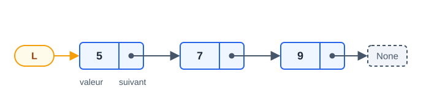

# CM2 — Listes chaînées, en bref

**Définitions**
```text
structure noeud : valeur : entier ; suivant : pointeur sur noeud
type liste = pointeur sur noeud          // liste vide = None
```
- `P = L` copie l'adresse (même nœud) ; `C-> = A->` copie la valeur (objet distinct).
- Insertion en début : O(1), mais l'ordre s'inverse. Suppression du dernier : O(n), s'arrêter sur l'avant-dernier.



**Patrons à retenir**
- Récursif : `si L = None alors <cas de base>` puis traiter `L->valeur` et appeler sur `L->suivant`.
- Construire en récursif : `res->suivant = f(L->suivant)` ; sauter un nœud : `retourner f(L->suivant)`.
- Construire en itératif (tête/queue) : `si tete = None alors tete = nv sinon queue->suivant = nv` puis `queue = nv`.

| Piège | Bon réflexe |
|---|---|
| `tant que tmp <> None` pour ajouter en fin | `tant que tmp->suivant <> None` : s'arrêter SUR le dernier |
| Oublier le cas `L = None` | Tester liste vide, un nœud, tête, fin, absent |
| Appeler `ajoutEnFin(L, x)` sans récupérer le résultat | `L = ajoutEnFin(L, x)` |
| Écrire `dx` au lieu de `L->dx` | Toujours passer par le pointeur du nœud |
| Croire que `P = L` fait une copie | Copier nœud par nœud avec `Nouveau` |
