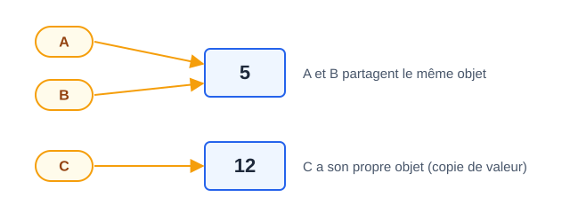

# CM 2 — Pointeurs, structures récursives et listes chaînées

> **Info :** Annale 2024-2025 : 6 pts (listes chaînées)
> Redéfinir `structure noeud` + `type liste`, parcours, coût, **construction d'une nouvelle liste filtrée en récursif ET en itératif** (patron tête/queue).

## À savoir faire
- Définir une Structure (enregistrement) et utiliser la notation pointée.
- Distinguer **copie d'adresse** et **copie de valeur** avec des pointeurs.
- Utiliser `Nouveau(type)` / `désallouer(p)` → Allocation dynamique.
- Écrire la Structure récursive `noeud` et le type `liste` **de mémoire**.
- Parcourir, afficher, copier, inverser une Liste chaînée (récursif + itératif).
- Construire une nouvelle liste **dans l'ordre** en itératif → Construire une liste en sortie.
- Supprimer le dernier nœud **sans bug** (s'arrêter sur l'avant-dernier).

## L'essentiel

### 1. La définition à connaître par cœur
```text
structure noeud
  valeur : entier
  suivant : pointeur sur noeud

type liste = pointeur sur noeud      // alias : liste ≡ pointeur sur noeud
```
- Liste vide = `None`. Le dernier nœud a `suivant = None`.
- `p->valeur` est un raccourci pour `p->.valeur`.


### 2. Copie d'adresse ≠ copie de valeur (piège classique)
```text
A = Nouveau(entier) ; A-> = 12
B = A                               // B pointe sur le MÊME objet
C = Nouveau(entier) ; C-> = A->     // C a son propre objet
A-> = 5
afficher A->, B->, C->              // 5 5 12
```

> Conséquence directe : dans TD2 - Listes chaînées Q3, `P = L` puis `P->suivant->valeur = 8` **modifie L**.

### 3. Les opérations de base (versions sûres)

**Insertion en début — O(1)**
```text
insertionDebut(L : liste, n : entier) : liste
  tmp : liste ; tmp = Nouveau(noeud)
  tmp->valeur = n
  tmp->suivant = L
  retourner tmp
```
> Construire 5,7,9 par insertions en début : insérer **9 puis 7 puis 5** (l'ordre s'inverse).

**Copie récursive** (le patron le plus utile à l'examen)
```text
copieListeRec(L : liste) : liste
  si L = None alors retourner None
  res : liste ; res = Nouveau(noeud)
  res->valeur = L->valeur
  res->suivant = copieListeRec(L->suivant)
  retourner res
```

**Copie itérative** — patron tête/queue (⚠️ la version du diaporama oublie d'affecter `res`, voici la version correcte)
```text
copieListeIt(L : liste) : liste
  si L = None alors retourner None
  res, queue : liste
  res = Nouveau(noeud) ; res->valeur = L->valeur ; res->suivant = None
  queue = res                          // queue = dernier nœud de la copie
  L = L->suivant
  tant que L <> None faire
    queue->suivant = Nouveau(noeud)
    queue = queue->suivant
    queue->valeur = L->valeur ; queue->suivant = None
    L = L->suivant
  retourner res
```

**Inversion (copie à l'envers)** : insérer en début un à un → voir Inversion d'une liste.

**Suppression du dernier nœud — O(n)** (⚠️ la version du diaporama ne remet pas l'avant-dernier à `None` : il faut s'arrêter sur l'**avant-dernier**)
```text
suppressionFin(L : liste) : liste
  si L = None alors retourner None
  si L->suivant = None alors            // un seul nœud
    désallouer(L) ; retourner None
  tmp : liste ; tmp = L
  tant que tmp->suivant->suivant <> None faire
    tmp = tmp->suivant                  // tmp = avant-dernier
  désallouer(tmp->suivant)
  tmp->suivant = None
  retourner L
```

### 4. Réflexe « tous les cas »
Pour toute procédure sur liste, vérifier : **liste vide**, **un seul nœud**, élément **absent**, élément **en tête**, élément **en fin**.

## Questions de vérification
1. Que contient la variable `N` si `N : pointeur sur entier` ? Et `N->` ?
2. Pourquoi écrire `R-> = 3.21` sans `Nouveau` est une erreur ?
3. Pourquoi une procédure qui modifie la liste doit-elle **retourner** la liste ?
4. Pourquoi la première tentative de `suppressionFin` ne fait rien ?
5. Coût de l'insertion en début ? en fin ?
