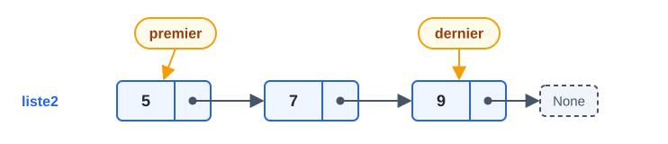
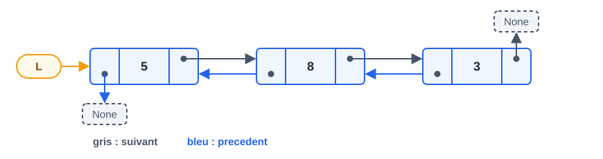
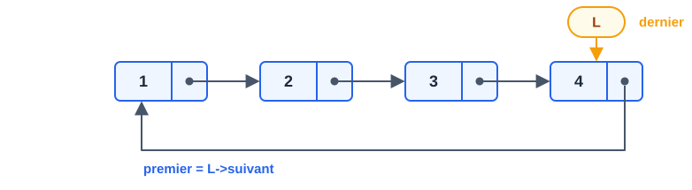

# CM 3 — Listes à deux pointeurs, doublement chaînées et circulaires

> **Info :** Rôle dans le cours
> Pas d'exercice dédié dans l'annale 2024-2025, mais c'est **la justification des coûts** des piles et files (CM4) : « pourquoi une file en O(1) ? → liste à deux pointeurs ou circulaire ».

## À savoir faire
- Citer les limites de la liste simple : un seul sens, **insertion/suppression en fin en O(n)**.
- Écrire `structure liste2` et `insereEnFin` en O(1) → Liste à deux pointeurs.
- Écrire `structure noeudDouble` et l'insertion/suppression en tête → Liste doublement chaînée.
- Expliquer pourquoi on pointe sur le **dernier** nœud d'une Liste circulaire.
- Remplir le tableau des coûts ci-dessous de mémoire.

## Le tableau qui résume tout le chapitre

| Opération | Liste simple (`L` = 1er) | Liste à 2 pointeurs | Liste circulaire (`L` = dernier) | Doublement chaînée |
|---|---|---|---|---|
| Insertion début | **O(1)** | **O(1)** | **O(1)** | **O(1)** |
| Suppression début | **O(1)** | **O(1)** | **O(1)** | **O(1)** |
| Insertion fin | O(n) | **O(1)** | **O(1)** | O(n)* |
| Suppression fin | O(n) | O(n) ⚠️ | O(n) ⚠️ | O(n)* |
| Retour en arrière | ✗ | ✗ | ✗ | ✓ |

\* O(1) si on garde aussi un pointeur sur le dernier nœud.
> **Règle** : on choisit la structure selon les opérations **les plus utilisées** ; on évite les opérations coûteuses. Suppression en fin reste O(n) dès qu'il faut trouver l'**avant-dernier** sans pointeur `precedent`.

## L'essentiel

### 1. Liste à deux pointeurs
```text
structure liste2
  premier : pointeur sur noeud
  dernier : pointeur sur noeud
```

```text
insereEnFin(L : liste2, n : entier)          // pas besoin de retourner : on modifie les champs
  tmp : pointeur sur noeud
  tmp = Nouveau(noeud) ; tmp->valeur = n ; tmp->suivant = None
  si L.premier = None alors
    L.premier = tmp ; L.dernier = tmp
  sinon
    L.dernier->suivant = tmp
    L.dernier = tmp
```
> ⚠️ Toujours penser à mettre à jour `dernier` quand la liste devient vide (suppression du seul nœud).

**À toi de jouer — `insereEnFin` pas à pas** sur une liste à deux pointeurs (5 → 7), pour ajouter 9
```pas-a-pas
{
  "titre": "insereEnFin(L, 9) sur la liste à deux pointeurs 5 → 7",
  "code": [
    "insereEnFin(L : liste2, n : entier)",
    "  tmp : pointeur sur noeud",
    "  tmp = Nouveau(noeud) ; tmp->valeur = n ; tmp->suivant = None",
    "  si L.premier = None alors",
    "    L.premier = tmp ; L.dernier = tmp",
    "  sinon",
    "    L.dernier->suivant = tmp",
    "    L.dernier = tmp"
  ],
  "etapes": [
    {"ligne":0,"vars":{"n":9},"note":"La structure liste2 garde deux pointeurs : premier et dernier.","schema":{"type":"liste","noeuds":[{"v":"5","suivant":1},{"v":"7","suivant":null}],"pointeurs":{"premier":0,"dernier":1}}},
    {"ligne":2,"note":"On crée le nœud 9, qui sera le dernier : son suivant est None.","schema":{"type":"liste","noeuds":[{"v":"5","suivant":1},{"v":"7","suivant":null},{"v":"9","suivant":null}],"pointeurs":{"premier":0,"dernier":1,"tmp":2}}},
    {"ligne":3,"note":"L.premier n'est pas None : la liste n'est pas vide, on passe au « sinon »."},
    {"ligne":6,"note":"Grâce à dernier, on accroche tmp directement derrière le dernier nœud, sans parcourir la liste.","schema":{"type":"liste","noeuds":[{"v":"5","suivant":1},{"v":"7","suivant":2},{"v":"9","suivant":null}],"pointeurs":{"premier":0,"dernier":1,"tmp":2}}},
    {"ligne":7,"note":"dernier avance sur le nouveau nœud. Tout s'est fait en O(1) : c'est l'intérêt de ce pointeur.","schema":{"type":"liste","noeuds":[{"v":"5","suivant":1},{"v":"7","suivant":2},{"v":"9","suivant":null}],"pointeurs":{"premier":0,"dernier":2,"tmp":2}}}
  ]
}
```

### 2. Liste doublement chaînée
```text
structure noeudDouble
  precedent : pointeur sur noeudDouble
  valeur : entier
  suivant : pointeur sur noeudDouble
type listeDouble = pointeur sur noeudDouble
```

Insertion en tête : créer `tmp` (precedent = None), `tmp->suivant = L`, **si L ≠ None** `L->precedent = tmp`, retourner `tmp`.
Suppression en tête : `tmp = L->suivant`, `désallouer(L)`, **si tmp ≠ None** `tmp->precedent = None`, retourner `tmp`.

### 3. Liste circulaire (pointeur sur le **dernier**)

- Premier nœud = `L->suivant` → accès en O(1) au début **et** à la fin.
- Pas besoin d'un nouveau type de nœud. Liste à 1 nœud : `L->suivant = L`.

```text
insertionCirculaireDebut(L : liste, n : entier) : liste
  tmp : liste ; tmp = Nouveau(noeud) ; tmp->valeur = n
  si L = None alors
    tmp->suivant = tmp ; retourner tmp
  tmp->suivant = L->suivant        // tmp devant l'ancien premier
  L->suivant = tmp                 // le dernier pointe sur le nouveau premier
  retourner L                      // L reste le dernier

insertionCirculaireFin(L : liste, n : entier) : liste
  L = insertionCirculaireDebut(L, n)   // on insère en tête...
  retourner L->suivant                 // ...puis le nouveau nœud devient le dernier
```
> L'astuce de l'insertion en fin (même code + décaler `L` d'un cran) est typique : à savoir expliquer.

**À toi de jouer — `insertionCirculaireDebut` pas à pas** : on ajoute 3 en tête de la liste circulaire 5 → 7 → 9 (L pointe sur le **dernier**)
```pas-a-pas
{
  "titre": "insertionCirculaireDebut(L, 3) sur la liste circulaire 5 → 7 → 9",
  "code": [
    "insertionCirculaireDebut(L : liste, n : entier) : liste",
    "  tmp : liste ; tmp = Nouveau(noeud) ; tmp->valeur = n",
    "  si L = None alors",
    "    tmp->suivant = tmp ; retourner tmp",
    "  tmp->suivant = L->suivant",
    "  L->suivant = tmp",
    "  retourner L"
  ],
  "etapes": [
    {"ligne":0,"vars":{"n":3},"note":"La liste est circulaire : le dernier nœud (9) pointe sur le premier (5). L désigne le dernier.","schema":{"type":"liste","noeuds":[{"v":"5","suivant":1},{"v":"7","suivant":2},{"v":"9","suivant":0}],"pointeurs":{"L":2}}},
    {"ligne":1,"note":"On crée le nœud 3, pas encore relié à la liste.","schema":{"type":"liste","noeuds":[{"v":"3","suivant":null},{"v":"5","suivant":2},{"v":"7","suivant":3},{"v":"9","suivant":1}],"pointeurs":{"L":3,"tmp":0}}},
    {"ligne":2,"note":"L n'est pas None : la liste n'est pas vide, on saute le cas particulier."},
    {"ligne":4,"note":"tmp->suivant = L->suivant : le nouveau nœud pointe sur l'ancien premier (5), qui est le suivant du dernier.","schema":{"type":"liste","noeuds":[{"v":"3","suivant":1},{"v":"5","suivant":2},{"v":"7","suivant":3},{"v":"9","suivant":1}],"pointeurs":{"L":3,"tmp":0}}},
    {"ligne":5,"note":"L->suivant = tmp : le dernier nœud pointe maintenant sur le nouveau premier. La boucle est refermée : 3 → 5 → 7 → 9 → 3.","schema":{"type":"liste","noeuds":[{"v":"3","suivant":1},{"v":"5","suivant":2},{"v":"7","suivant":3},{"v":"9","suivant":0}],"pointeurs":{"L":3,"tmp":0}}},
    {"ligne":6,"note":"On retourne L : il reste le dernier nœud. Le début de la liste est L->suivant, soit 3.","schema":{"type":"liste","noeuds":[{"v":"3","suivant":1},{"v":"5","suivant":2},{"v":"7","suivant":3},{"v":"9","suivant":0}],"pointeurs":{"L":3}}}
  ]
}
```

## Questions de vérification
1. Pourquoi la suppression en fin est-elle O(n) même avec un pointeur `dernier` ?
2. Dans une liste circulaire, pourquoi pointer sur le dernier plutôt que sur le premier ?
3. Quels pointeurs faut-il modifier pour insérer en tête d'une liste doublement chaînée ?
4. Quelle structure choisir pour implémenter une file en O(1) ?
