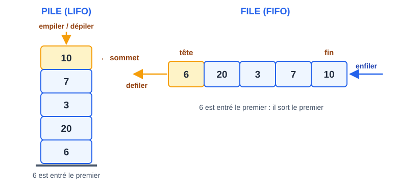

# CM 4 — Piles et files

> **Info :** À retenir
> Utiliser une pile ou une file uniquement par son interface (`fileVide`, `tete`, `defiler`, `enfiler`).
> Les piles servent aussi à **dérécursiver** (lien avec les arbres des CM suivants).

## À savoir faire
- Donner les **5 fonctions d'interface** d'une Pile et d'une File (signatures exactes).
- Expliquer la notion de Type abstrait : on utilise une pile sans connaître son implémentation.
- Implémenter une pile avec un tableau (`P[0]` = nombre d'éléments) et avec une liste chaînée.
- Expliquer pourquoi tableau et liste simple sont **mal adaptés** à une file, et quelle structure choisir.
- Écrire Bon parenthésage (compteur puis pile à 2 types de parenthèses).
- Dérécursiver avec une pile → Pile d'appels.
- Connaître le résultat des Tours de Hanoï : 2ⁿ − 1 déplacements.

## Pile vs file en un coup d'œil



| | Pile (LIFO) | File (FIFO) |
|---|---|---|
| Créer | `initPile() : pile` | `initFile() : file` |
| Tester | `pileVide(p) : booléen` | `fileVide(f) : booléen` |
| Lire | `sommet(p) : entier` | `tete(f) : entier` |
| Ajouter | `empiler(p, x) : pile` | `enfiler(f, x) : file` |
| Retirer | `depiler(p) : pile` | `defiler(f) : file` |

> ⚠️ `sommet`/`tete`/`depiler`/`defiler` supposent la structure **non vide** : toujours tester `pileVide`/`fileVide` **avant**.

## Implémentations et coûts

| Implémentation | Pile | File |
|---|---|---|
| Tableau (`T[0]` = nb d'éléments) | tout en **O(1)** ✅ (mais capacité max) | `defiler` en **O(n)** (décalage à gauche) ❌ |
| Liste simple (tête = 1er nœud) | tout en **O(1)** ✅ (empiler/dépiler = début) | `enfiler` en **O(n)** (insertion en fin) ❌ |
| Liste à deux pointeurs | — | tout en **O(1)** ✅ |
| Liste circulaire (ptr sur dernier) | — | tout en **O(1)** ✅ |

### Pile avec une liste chaînée (à savoir écrire)
```text
type pile = pointeur sur noeud
initPile() : pile                  retourner None
pileVide(P : pile) : booléen       retourner P = None
sommet(P : pile) : entier          retourner P->valeur
empiler(P : pile, x : entier) : pile
  tmp : pile ; tmp = Nouveau(noeud) ; tmp->valeur = x ; tmp->suivant = P
  retourner tmp
depiler(P : pile) : pile
  tmp : pile ; tmp = P->suivant
  désallouer(P)
  retourner tmp                    // on ne peut pas retourner P->suivant après désallocation
```

### Pile avec un tableau
```text
initPile() : tableau d'entiers
  P[maxPile] : tableau d'entiers ; P[0] = 0 ; retourner P
pileVide(P : tableau d'entiers) : booléen
  retourner P[0] = 0
sommet(P : tableau d'entiers) : entier
  retourner P[P[0]]
empiler(P : tableau d'entiers, x : entier) : tableau d'entiers
  si P[0] < maxPile - 1 alors          // sinon pile pleine : on ne fait rien
    P[0] = P[0] + 1 ; P[P[0]] = x
  retourner P
depiler(P : tableau d'entiers) : tableau d'entiers
  P[0] = P[0] - 1                      // pile supposée non vide
  retourner P
```

## Deux applications de cours
**Bon parenthésage** — voir Bon parenthésage :
```text
bienParenthese(C : chaîne de caractères) : booléen
  P : pile ; P = initPile()
  pour i de 0 à longueur(C) - 1 faire
    si C[i] = '(' alors P = empiler(P, '(')
    si C[i] = ')' alors
      si pileVide(P) alors retourner Faux     // trop de fermantes
      P = depiler(P)
  retourner pileVide(P)                       // sinon trop d'ouvrantes
```
**Tours de Hanoï** — 3 piles, on ne pose jamais un disque sur un plus petit ; solution optimale : **2ⁿ − 1** déplacements (15 pour n = 4).

## Questions de vérification
1. Donner les 5 signatures d'une file.
2. Pourquoi une pile peut-elle être implémentée efficacement par une liste simple mais pas une file ?
3. Avec un tableau, pourquoi la pile contient au plus `maxPile − 1` éléments ?
4. Pourquoi un compteur suffit avec un seul type de parenthèse, mais pas avec deux ?
5. Pour « revenir en arrière » et pour « traiter dans l'ordre d'arrivée », quelle structure choisir ?
