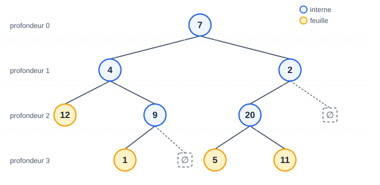

# CM 5 — Structures arborescentes

> **Info :** Annale 2024-2025 : 3 pts arbres binaires (comptage récursif, coût n) + 6 pts forêts (accumulateur sur une branche)
> Arbres binaires : redéfinir `noeud`/`arbreBinaire`, écrire des parcours récursifs, compter les nœuds vérifiant une condition, **coût en fonction de n**.
> Forêts (représentation premier enfant / fratrie, vue aux CM suivants) : parcourir les branches avec un accumulateur.

## À savoir faire
- Donner les définitions inductives d'un Arbre général et d'un Arbre binaire.
- Utiliser le vocabulaire : racine, enfant, parent, descendant, Nœud interne et feuille, Branche.
- Calculer Profondeur et hauteur, Longueur de cheminement (interne / externe) sur un dessin.
- Écrire N(A), N_f(A), N_i(A), h(A) **inductivement** → et donc en **procédure récursive**.
- Écrire `structure noeud` (valeur, gauche, droit) + `type arbreBinaire`.
- Donner l'ordre de visite en largeur et en profondeur (préfixe, infixe, suffixe).

## Arbre exemple du cours (à savoir exploiter)



| Mesure | Valeur | Calcul |
|---|---|---|
| N(A) nœuds | 9 | |
| N_f(A) feuilles | 4 | 12, 1, 5, 11 |
| N_i(A) internes | 5 | 7, 4, 9, 2, 20 → N = N_i + N_f ✔ |
| Hauteur h | 3 | profondeur max (1, 5, 11) |
| LC (cheminement) | 17 | 0 + 1+1 + 2+2+2 + 3+3+3 |
| LCE (externe) | 11 | 2 + 3+3+3 (feuilles seulement) |
| Largeur | 7 4 2 12 9 20 1 5 11 | niveau par niveau |
| Préfixe | 7 4 12 9 1 2 20 5 11 | 1ʳᵉ visite |
| Infixe | 12 4 1 9 7 5 20 11 2 | 2ᵉ visite |
| Suffixe | 12 1 9 4 5 11 20 2 7 | 3ᵉ visite |

> **Astuce :** Méthode « trois visites » : on fait le tour de l'arbre en longeant les branches par la gauche. Chaque nœud est rencontré 3 fois (avant G, entre G et D, après D). Préfixe = on note à la 1ʳᵉ, infixe à la 2ᵉ, suffixe à la 3ᵉ.

## L'essentiel

### 1. Structure
```text
structure noeud
  valeur : entier
  gauche : pointeur sur noeud
  droit : pointeur sur noeud
type arbreBinaire = pointeur sur noeud      // arbre vide = None
```

### 2. Des définitions inductives aux procédures récursives
Chaque définition du cours se traduit **mot pour mot** en procédure — c'est exactement ce que demande l'examen.

| Définition inductive | Procédure |
|---|---|
| N(∅) = 0 ; N(A) = 1 + N(A_g) + N(A_d) | `si A = None retourner 0` ; `retourner 1 + taille(A->gauche) + taille(A->droit)` |
| N_f(∅) = 0 ; N_f(•) = 1 ; sinon N_f(A_g) + N_f(A_d) | tester `A->gauche = None et A->droit = None` pour la feuille |
| h(∅) = −1 ; h(A) = 1 + max(h(A_g), h(A_d)) | `retourner 1 + max(hauteur(A->gauche), hauteur(A->droit))` |

```text
nombreFeuilles(A : arbreBinaire) : entier
  si A = None alors retourner 0
  si A->gauche = None et A->droit = None alors retourner 1
  retourner nombreFeuilles(A->gauche) + nombreFeuilles(A->droit)

affichagePrefixe(A : arbreBinaire)            // infixe / suffixe : déplacer le "afficher"
  si A <> None alors
    afficher A->valeur
    affichagePrefixe(A->gauche)
    affichagePrefixe(A->droit)
```

### 3. Coût : n ou h ?
- On visite **tous** les nœuds (compter, afficher, chercher sans pouvoir s'arrêter) → coût **n** (nombre de nœuds).
- On ne suit **qu'une branche** (on choisit gauche OU droite) → coût ≤ **h + 1** nœuds (hauteur).

## Questions de vérification
1. Quelle est la hauteur de l'arbre vide ? de l'arbre réduit à sa racine ?
2. Combien de branches a un arbre ? (indice : lien avec les feuilles)
3. Différence entre longueur de cheminement et longueur de cheminement externe ?
4. Donner les 4 parcours de l'arbre ci-dessus sans regarder.
5. Un parcours qui s'arrête dès qu'il trouve une valeur : quel coût dans le pire cas ?
