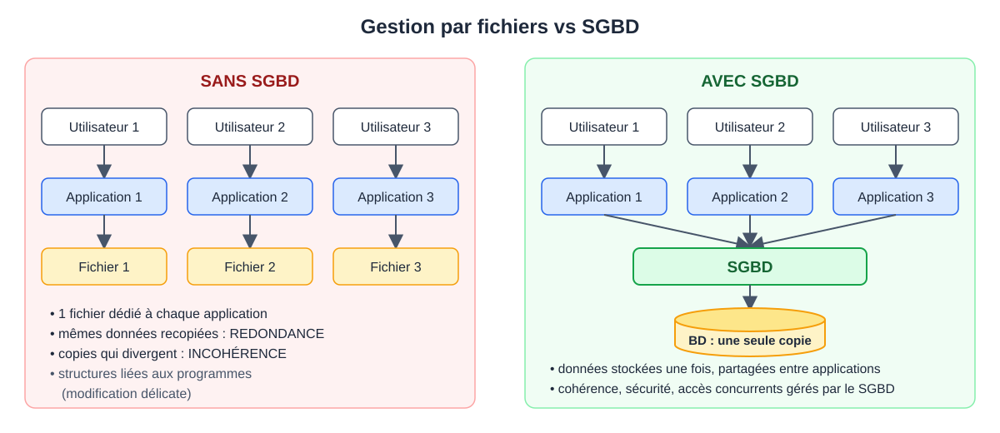
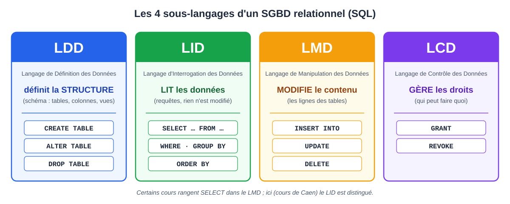
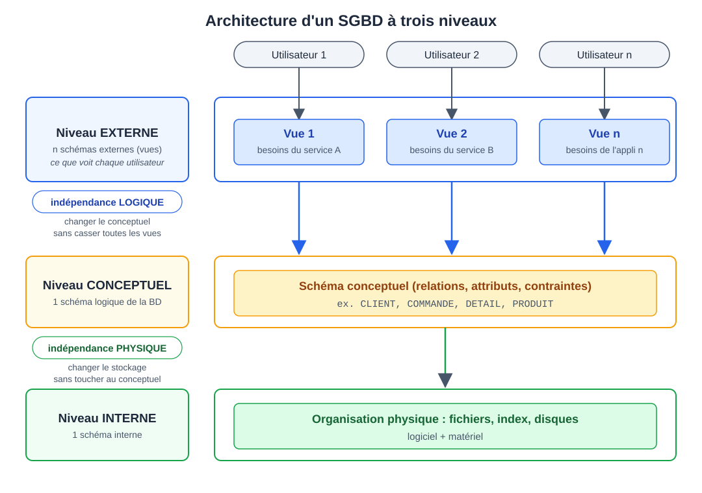

# CM 1 — Introduction aux bases de données

> **Info :** Pas d'annale disponible pour cette matière. Sources : chapitre 01-Introduction, diapos 01-diaposIntroBD, schémas du cours.

## À savoir faire
- Expliquer pourquoi les données doivent être stockées de façon unique.
- Définir un SGBD et expliquer son rôle (et le distinguer d'une base de données).
- Identifier les limites d'une gestion par fichiers.
- Distinguer les niveaux externe, conceptuel et interne.
- Associer LDD, LID, LMD et LCD à leur rôle.
- Expliquer les problèmes du tableau personnes-pays (redondance, incohérence, perte d'information).

## L'essentiel

### 1. Pourquoi une base de données ?
Des applications différentes ont besoin des **mêmes données** (ex. les horaires d'un même train affichés sur plusieurs pages web). Il faut donc les stocker **de façon unique**.

### 2. Limites de la gestion par fichiers
Avec un fichier par application :
- **Redondance** : perte d'espace, et cohérence non assurée.
- **Dépendance données / traitements** : modifier une structure est délicat.
- **Multiplicité des normes** (formats différents d'un fichier à l'autre).

### 3. Le SGBD
Apparu dans les années 1960. Apports : pas de redondance, séparation données / traitements, administration (multi-utilisateur, point de vue global).

**Définition** : système matériel et logiciel pour **rechercher, insérer, modifier** les données avec un langage de haut niveau, et pour les **stocker et protéger**. L'utilisateur doit avoir l'impression d'être seul sur le système.

**Objectifs** : indépendance physique, indépendance logique, cohérence, partage, souplesse d'accès, performances, sécurité et contrôle.

> **Attention :** SGBD = le logiciel (ex. MySQL). Base de données = les données qu'il gère.

### 4. Les langages d'un SGBD
| Sigle | Rôle | Exemples |
|---|---|---|
| LDD (définition) | Définir la **structure** (le schéma) | CREATE, ALTER, DROP |
| LID (interrogation) | **Lire** les données | SELECT |
| LMD (manipulation) | Modifier le **contenu** | INSERT, UPDATE, DELETE |
| LCD (contrôle) | Gérer les **droits** | GRANT, REVOKE |

> **Info :** Certains cours rangent `SELECT` dans le LMD ; ici le LID est distingué.

### 5. Architecture à trois niveaux
- **Externe** : vue restreinte, les besoins d'un utilisateur.
- **Conceptuel** : le schéma de la base (structure logique complète).
- **Interne** : l'organisation physique (logiciel + matériel).

Chaque utilisateur ne voit qu'une vue externe ; toutes reposent sur **un seul** schéma conceptuel, lui-même indépendant du stockage physique.
- **Indépendance physique** : changer le stockage sans toucher au conceptuel.
- **Indépendance logique** : changer le conceptuel sans casser toutes les vues.

### 6. Modèles de BD et limites d'un tableur
Modèles : réseau, hiérarchique (historiques), **relationnel**, orienté objet…

Exemple d'un tableau unique personnes + pays visités :

| nom | ville | datenaissance | nom pays |
|---|---|---|---|
| chloe | caen | 1997-01-15 | macedoine |
| chloe | caen | 1997-01-15 | irlande |
| mehdi | caen | 1997-06-18 | irlande |
| mehdi | caen | 1997-06-18 | perou |
| helena | paris | 1996-09-08 | perou |

- **Redondance** : les infos d'une personne sont répétées à chaque voyage.
- **Incohérence** : si chloe déménage, il faut modifier chacune de ses lignes.
- **Perte d'information** : supprimer « perou » supprime aussi helena (elle n'a visité que ce pays).
- **Solution** : dissocier personnes et pays (modèle relationnel : tables Personne, Pays, Voyage, vues au CM2).

## Questions de vérification
1. Pourquoi plusieurs fichiers contenant les mêmes données posent-ils problème ?
2. Quel est le rôle d'un SGBD ?
3. Quelle différence entre les niveaux externe, conceptuel et interne ?
4. Quelle différence entre LDD, LID, LMD et LCD ?
5. Pourquoi le tableau personnes-pays contient-il de la redondance ? Quelle anomalie à la suppression ?
