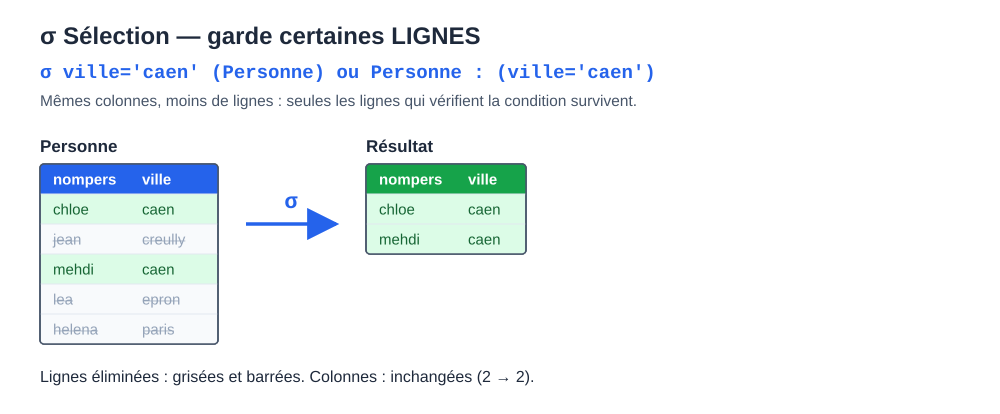
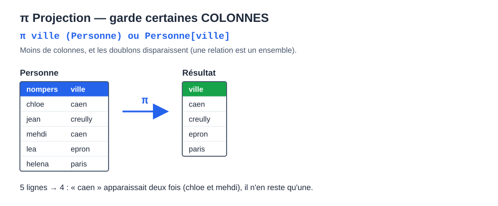
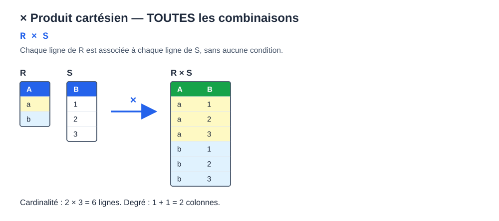
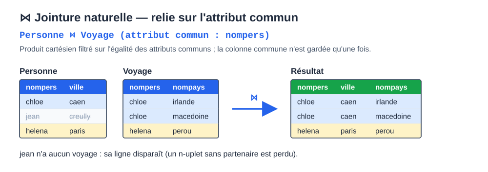
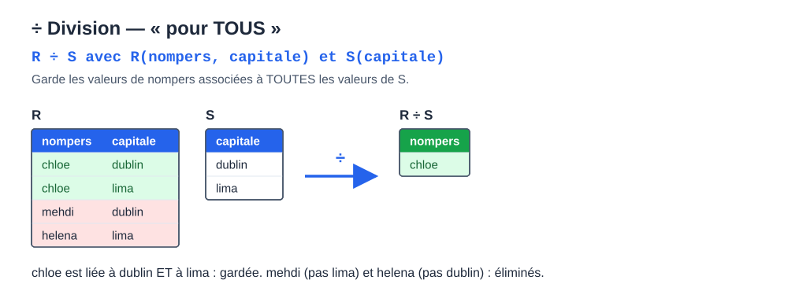

# CM 2 — Modèle relationnel et algèbre relationnelle

> **Info :** Pas d'annale de Bases de données disponible : sources = diapos du CM2 (Crémilleux), TD1-2 (algèbre relationnelle) et chapitre de cours.

## À savoir faire
- Définir domaine, relation, attribut et n-uplet.
- Distinguer schéma et extension, degré et cardinalité.
- Définir une clé candidate (et situer clé primaire, clé étrangère).
- Appliquer les opérateurs fondamentaux : projection, sélection, union, différence, produit cartésien.
- Comprendre jointure naturelle et thêta-jointure comme un produit cartésien filtré.
- Traduire « aucun / jamais » par une différence et « pour tous » par une division.

## L'essentiel

### 1. Le modèle relationnel
- Codd (IBM), 1970. Succès dû à un modèle **simple** (la table) et à des **fondements mathématiques solides** (algèbre relationnelle, théorie des ensembles). Langages non procéduraux.
- **Domaine** : ensemble des valeurs possibles d'un attribut (nombres, chaînes, dates, énumérés…).
- **Relation** : sous-ensemble du produit cartésien d'une liste de domaines. **Attribut** : une colonne. **N-uplet** : une ligne.
- Pas d'ordre sur les colonnes ni sur les lignes ; pas de doublon (modèle ensembliste) : deux n-uplets diffèrent par au moins un attribut.

### 2. Schéma, extension, degré, cardinalité
| Terme | Sens |
|---|---|
| Schéma (intension) | nom de la relation, attributs et domaines, signification |
| Extension | ensemble des n-uplets actuels (change à chaque insertion/suppression) |
| Degré | nombre d'attributs |
| Cardinalité | nombre de n-uplets |

Exemple : `Personne(nompers, ville, datenaissance)` avec 5 lignes → degré 3, cardinalité 5.

### 3. Clés et base relationnelle
- **Clé candidate** : ensemble d'attributs dont les valeurs déterminent un unique n-uplet. On cherche les clés de longueur minimale. Il en existe toujours au moins une (l'ensemble de tous les attributs, car pas de doublon).
- **Clé primaire** : la clé candidate choisie (une par table). **Clé étrangère** : attribut dont les valeurs doivent exister comme clé primaire d'une autre table.
- Exemple (base Commandes) : `DETAIL(RefCom, RefP, Quantité)` a pour clé (RefCom, RefP) ; `RefP` y est aussi clé étrangère vers `PRODUIT`.
- **Base relationnelle** = relations (schémas + extensions) + contraintes (valeurs autorisées, unicité, clés étrangères).



### 4. Algèbre relationnelle
| Opération | Notation du cours | Rôle |
|---|---|---|
| Projection | `R[A]` (ou π) | garder des **colonnes**, sans doublon |
| Sélection | `R:(F)` (ou σ) | garder des **lignes** |
| Union | `R ∪ S` | réunir deux relations compatibles |
| Différence | `R − S` | lignes de R absentes de S |
| Produit cartésien | `R × S` | toutes les combinaisons |
| Intersection | `R ∩ S` | `= R − (R − S)` |
| Jointure naturelle | `R ⋈ S` | égalité sur les attributs communs |
| Thêta-jointure | `R ⋈(F) S` | `= (R × S) : F` |
| Division | `R / S` | « pour tous » |

Fondamentaux : projection, sélection, union, différence, produit. Les autres s'en déduisent. **Fermeture** : le résultat de toute opération est une relation, donc réutilisable.



### 5. Produit cartésien et jointures
Exemple du cours : Personne (5 n-uplets) et Voyage (5 n-uplets).
- `Personne × Voyage` : 5 × 5 = **25** n-uplets.
- `Personne ⋈ Voyage` (sur `nompers`) : **5** n-uplets ; jean et lea disparaissent (pas de voyage).
- Personnes de Caen et pays visités : `((Personne ⋈ Voyage) : (ville='caen'))[nompers, nompays]` → (chloe, macedoine), (chloe, irlande), (mehdi, irlande), (mehdi, perou).
- Limite : `R ⋈ S` ne permet pas toujours de retrouver R et S (on perd les personnes sans voyage et les pays non visités).





**Thêta-jointure** : condition F quelconque. Paires de personnes de même ville, avec `P1 = Personne ; P2 = Personne` :
```text
(P1 ⋈(P1.ville = P2.ville ∧ P1.nompers < P2.nompers) P2)[P1.nompers, P2.nompers]
```
Résultat : (chloe, mehdi). Sans la condition `<` : **7** n-uplets (chaque personne avec elle-même et les paires dans les deux sens).

> **Astuce :** `R ⋈ S` = produit cartésien filtré par l'égalité des attributs communs ; la thêta-jointure autorise n'importe quelle condition.

### 6. Négation et « au moins un » (TD1-2)
- « au moins un / qui ont » → jointure puis projection.
- « aucun / jamais » → différence `A[X] − B[X]` (projeter d'abord sur les mêmes attributs).
- Exemple (Commandes) : `PRODUIT[RefP] − DETAIL[RefP]` = produits jamais commandés.
- « les deux à la fois » → intersection, soit `A − (A − B)`.
- « pour chaque ville… qui n'a aucun » → produit cartésien − jointure.

### 7. Division
```text
(Voyage ⋈ Pays)[nompers, capitale] / Pays[capitale]
```
Garde les personnes associées à **toutes** les capitales de Pays (dans l'exemple du cours : chloe seule). Signal dans l'énoncé : « toutes les… », « tous les… ».



## Questions de vérification
1. Quelle différence entre schéma et extension ? entre degré et cardinalité ?
2. Quelle opération filtre les colonnes ? les lignes ?
3. Combien de n-uplets dans le produit de deux relations de cardinalité 5 et 5 ?
4. Comment exprimer l'intersection sans le symbole ∩ ?
5. Quel mot de l'énoncé annonce une division ?
