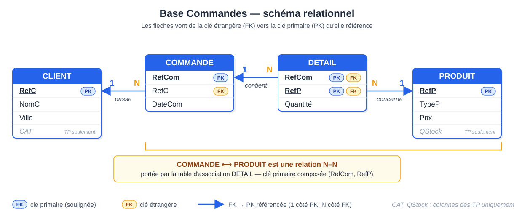

# CM 4 — SQL : agrégats, sous-requêtes, jointures externes

> **Info :** Pas d'annale pour cette matière. Sources : chapitre « SQL – suite », diapos `diaposSqlMysqlSuite.pdf` (diapos 40 à 66), TD5-6 et TP3 (corrections).
> Base utilisée partout : `CLIENT(RefC, NomC, Ville, CAT)`, `PRODUIT(RefP, TypeP, Prix, QStock)`, `COMMANDE(RefCom, RefC, DateCom)`, `DETAIL(RefCom, RefP, Quantite)`.



## À savoir faire
- Calculer avec un **agrégat**, regrouper avec `GROUP BY`, filtrer les groupes avec `HAVING`.
- Choisir entre jointure, `IN`/`NOT IN`, `EXISTS`/`NOT EXISTS`, sous-requête scalaire, sous-requête dans le `FROM`.
- Exprimer la **non-appartenance** (« n'a jamais ») et les **extrema** (« le plus cher »).
- Ne pas perdre les lignes « à zéro » : **jointure externe** (`LEFT JOIN`) ou `UNION`.
- Savoir pourquoi `NATURAL JOIN` est dangereux.
- Écrire une **division** (« pour tous ») : double `NOT IN` ou comptage.

## L'essentiel

### 1. Agrégats, GROUP BY, HAVING
- Un agrégat calcule **une valeur** sur un ensemble de lignes : `COUNT`, `SUM`, `AVG`, `MIN`, `MAX`. Les `NULL` sont ignorés, sauf par `COUNT(*)`.
- `COUNT(*)` : nombre de lignes ; `COUNT(A)` : valeurs non nulles ; `COUNT(DISTINCT A)` : valeurs non nulles distinctes.
- `GROUP BY` partitionne les lignes en groupes ; une ligne de résultat par groupe. Règle `only_full_group_by` : toute colonne non agrégée du `SELECT` figure dans le `GROUP BY`.
- `WHERE` filtre des **lignes** (avant regroupement, sans agrégat) ; `HAVING` filtre des **groupes** (après), généralement sur un agrégat.
- Pas d'agrégat imbriqué (`AVG(SUM(x))`) : passer par une sous-requête dans le `FROM`.
```sql
SELECT COM.RefC, SUM(P.Prix*D.Quantite)
FROM DETAIL D, COMMANDE COM, PRODUIT P
WHERE COM.RefCom = D.RefCom AND D.RefP = P.RefP
GROUP BY COM.RefC
HAVING SUM(P.Prix*D.Quantite) > 10000;
```
> **Attention :** une jointure interne fait disparaître les groupes « vides » (un produit jamais commandé n'a aucune ligne dans `DETAIL`).

### 2. Sous-requêtes
| Forme | Exemple | Contrainte |
|---|---|---|
| Liste de valeurs | `RefP NOT IN (SELECT RefP FROM DETAIL)` | une colonne (ou un n-uplet) |
| Valeur scalaire | `Prix = (SELECT MAX(Prix) FROM PRODUIT)` | 1 ligne × 1 colonne |
| Test d'existence | `NOT EXISTS (SELECT …)` | — |
| Table dérivée | `FROM (SELECT … GROUP BY …) T` | alias obligatoire |

- On imbrique pour : la non-appartenance, les extrema, des calculs à **granularités différentes** (comparaison, pourcentage), la division.
- Si deux conditions portent sur la **même** granularité, une simple jointure est plus lisible : pas d'imbrication.
- **Non corrélée** : exécutée une fois. **Corrélée** : elle référence la requête externe (`COM.RefC = C.RefC`) et est réévaluée pour chaque ligne externe.

Exemple TD5-6 (exercice 3, question 4) : montant moyen d'une commande. La sous-requête du `FROM` calcule le total de chaque commande, puis on prend `AVG(Total)` (résultat 37252.857143 sur les 7 commandes).

### 3. IN / NOT IN et EXISTS / NOT EXISTS
```sql
SELECT RefP FROM PRODUIT WHERE RefP NOT IN (SELECT RefP FROM DETAIL);          -- jamais commandés
SELECT C.NomC FROM CLIENT C
WHERE NOT EXISTS (SELECT * FROM COMMANDE COM WHERE COM.RefC = C.RefC);         -- corrélée
```
- Lecture de `NOT EXISTS` : « client C tel qu'**il n'existe pas** de commande faite par C ».
- Le test peut porter sur un n-uplet : `(RefP, RefC) NOT IN (SELECT …)`. Le type testé doit correspondre à celui de la sous-requête.
- **Piège `NULL`** : si la sous-requête renvoie un `NULL`, `x NOT IN (…)` n'est jamais vrai. `NOT EXISTS` est robuste aux `NULL`.
- Exemple TD5-6 (exercice 3, question 3) : les noms des clients qui n'ont commandé aucun des produits commandés par VANDERKA (11 clients).

### 4. Extrema : sous-requête scalaire et ALL / ANY
```sql
-- ERREUR : SELECT RefP, MAX(Prix) FROM PRODUIT;  (RefP n'est pas défini à la granularité de l'agrégat)
SELECT RefP, Prix FROM PRODUIT WHERE Prix = (SELECT MAX(Prix) FROM PRODUIT);
SELECT RefP, Prix FROM PRODUIT WHERE Prix >= ALL (SELECT Prix FROM PRODUIT);
```
- `x >= ALL (…)` : x est supérieur ou égal à **toutes** les valeurs ; `x > ANY (…)` : x dépasse **au moins une** valeur.
- `= ANY` équivaut à `IN` ; `ALL` sur un ensemble vide est vrai. Les deux écritures ci-dessus gèrent les ex æquo.
- Exemple TD5-6 (exercice 3, question 5) : la commande de montant maximal, avec `HAVING SUM(…) >= ALL (…)` (commande 5, total 169625).

### 5. Pourcentage : deux granularités
Nombre de produits **par client** (groupe) divisé par le nombre de produits **au total** (table) : `COUNT(DISTINCT D.RefP)*100 / (SELECT COUNT(*) FROM PRODUIT)`. Variante : deux sous-requêtes dans le `FROM`. Une colonne issue d'une sous-requête, placée à côté d'un `GROUP BY` et non agrégée, est refusée (erreur 1055).

### 6. Jointure externe, UNION, NATURAL JOIN
- `LEFT JOIN` garde **toutes** les lignes de la table de gauche, complétées par `NULL` sans correspondance à droite. `COALESCE(x, 0)` remplace `NULL` par 0.
```sql
SELECT C.RefC, COALESCE(SUM(D.Quantite), 0)
FROM CLIENT C LEFT JOIN COMMANDE CO ON C.RefC = CO.RefC
              LEFT JOIN DETAIL D    ON CO.RefCom = D.RefCom
GROUP BY C.RefC;
```
> **Attention :** mettre une condition sur la table de droite dans le `WHERE` annule l'effet du `LEFT JOIN` : la mettre dans le `ON`.
- `UNION` réunit deux `SELECT` de même schéma (même nombre de colonnes, types compatibles) et élimine les doublons ; `UNION ALL` les conserve.
- Le corrigé du TP3 (exercice 3, questions 7 et 8) utilise `UNION` pour ajouter les lignes « manquantes » : clients sans commande de clous avec la quantité 0, couples (ville, catégorie) à montant 0. Principe : un premier `SELECT ... GROUP BY` pour les lignes existantes, puis `SELECT RefC, 0 FROM CLIENT WHERE RefC NOT IN (…)`.
- `NATURAL JOIN` joint sur **tous les attributs de même nom**, sans regarder leur sens. Aucun attribut commun : produit cartésien silencieux (`CLIENT NATURAL JOIN COMMUNE` : 15 × 11 = 165 lignes). Même nom mais sens différent : résultat faux. Préférer `JOIN … ON` ou `WHERE` explicite.

### 7. Division (« pour tous »)

Signal dans l'énoncé : « tous », « chaque », « pour toutes ». Formule : `R/S = R[X] − ((R[X] × S) − R)[X]`.

**Double différence** : on retire les valeurs pour lesquelles il existe une valeur de S manquante.
```sql
SELECT COM.RefC FROM COMMANDE COM
WHERE COM.RefC NOT IN
  (SELECT COM.RefC FROM COMMANDE COM, PRODUIT P
   WHERE (COM.RefC, P.TypeP) NOT IN
     (SELECT COM.RefC, P.TypeP FROM COMMANDE COM, DETAIL D, PRODUIT P
      WHERE COM.RefCom = D.RefCom AND D.RefP = P.RefP));
```
**Comptage** (plus court) : on compare le nombre d'éléments du groupe au nombre total.
```sql
SELECT COM.RefC FROM COMMANDE COM, DETAIL D, PRODUIT P
WHERE COM.RefCom = D.RefCom AND D.RefP = P.RefP
GROUP BY COM.RefC
HAVING COUNT(DISTINCT P.TypeP) = (SELECT COUNT(DISTINCT TypeP) FROM PRODUIT);
```
- `DISTINCT` est indispensable : un client peut acheter plusieurs produits du même type.
- On part de `COMMANDE` (et non de `CLIENT`) dans le premier `SELECT` de la double différence : sinon un client sans aucune commande resterait à tort dans le résultat.
- Exemples : TD5-6 exercice 6 (villes dont les clients ont commandé tous les types : Toulouse) ; TP3 exercice 3 question 9 (villes où l'on trouve toutes les catégories de clients : Toulouse, 4 catégories).

### 8. Choisir son outil
| L'énoncé dit… | On écrit… |
|---|---|
| « n'a jamais / aucun / pas de » | `NOT IN` ou `NOT EXISTS` |
| « le plus / le moins » | `= (SELECT MAX/MIN …)` ou `>= ALL` |
| « tous / chaque / pour toutes » | division : comptage ou double `NOT IN` |
| « pourcentage / par rapport au total » | sous-requête scalaire ou dans le `FROM` |
| « sans oublier ceux qui n'ont rien » | `LEFT JOIN` ou `UNION` |

## Questions de vérification
1. Quelle différence entre `WHERE` et `HAVING` ?
2. Que doit renvoyer une sous-requête utilisée avec `<` ou `=` ?
3. Pourquoi `NOT IN` est-il dangereux avec des `NULL`, et pas `NOT EXISTS` ?
4. Comment obtenir « le produit le plus cher » avec `ALL` ?
5. Que fait un `LEFT JOIN` quand il n'y a pas de correspondance ?
6. Pourquoi la division par comptage exige-t-elle `DISTINCT` ?
