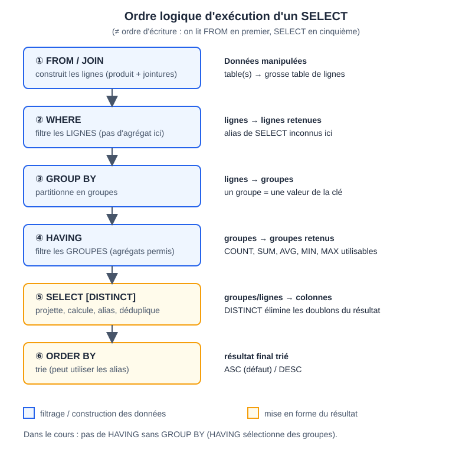

# CM 3 — SQL : langage de requêtes

> **Info :** Pas d'annale BD dans le dépôt. Sources : chapitre CM3, diapos `diaposSqlMysql.pdf` (1 à 39), TD3-4 / TP2 et son corrigé de résultats.
> Schéma de référence : la base **Commandes**.


```text
CLIENT(RefC, NomC, Ville, CAT)        PRODUIT(RefP, TypeP, Prix, QStock)
COMMANDE(RefCom, RefC, DateCom)       DETAIL(RefCom, RefP, Quantité)
```
Chemin de jointure habituel : CLIENT → COMMANDE → DETAIL → PRODUIT (via RefC, RefCom, RefP).

## À savoir faire
- Situer SQL : langage **déclaratif** (on dit ce qu'on veut, pas comment) ; sous-langages de définition, de manipulation, de contrôle.
- Créer une table (`CREATE TABLE`) avec clé primaire, puis la remplir (`INSERT`, `LOAD DATA`).
- Écrire un `SELECT … FROM … WHERE` et le traduire en algèbre (produit – sélection – projection).
- Utiliser `DISTINCT`, `ORDER BY`, `BETWEEN`, `LIKE`, `REGEXP`, les alias et le calcul arithmétique.
- Écrire une auto-jointure (paires) avec un `<` strict.
- Utiliser les agrégats avec `GROUP BY` et `HAVING`, et connaître l'ordre d'exécution.

## L'essentiel

### 1. SQL en bref
- Créé en 1974, normalisé depuis 1986. Langage déclaratif.
- Sous-langages : définition (`CREATE`, `ALTER`), manipulation (`INSERT`, `UPDATE`, `DELETE`, et `SELECT` selon les cours), contrôle (`GRANT`…).
- **Calcul sur n-uplets** : `CLIENT C` crée une variable typée `C` qui parcourt les lignes de CLIENT (ex. `C.NomC = 'GOFFIN'`).

### 2. Créer et remplir
```sql
CREATE TABLE DETAIL (
    RefCom   INT NOT NULL,
    RefP     VARCHAR(5) NOT NULL,
    Quantite INT NOT NULL,
    PRIMARY KEY (RefCom, RefP)      -- clé composée
);
INSERT INTO CLIENT VALUES (1, 'GOFFIN', 'Namur', 'B2');
LOAD DATA LOCAL INFILE 'client.dat' INTO TABLE CLIENT;   -- syntaxe MySQL
CREATE TABLE Copie AS SELECT ... ;                        -- table créée ET remplie
```
La table est **vide** après un simple `CREATE TABLE`. Une clé primaire est toujours non nulle.

### 3. Forme générale d'un SELECT
```sql
SELECT [DISTINCT] A1, ..., Am     -- projection / expressions calculées
FROM   R1, ..., Rn                -- produit cartésien des relations
WHERE  F                          -- sélection
ORDER BY Ai [ASC|DESC], ... ;     -- tri
```
Équivalent algébrique : `((R1 × … × Rn) : F)[A1,…,Am]`, c'est-à-dire **produit – sélection – projection**. La jointure s'écrit donc dans le `WHERE` (égalité des clés).

```sql
-- Toutes les infos du client qui a passé la commande 4
SELECT C.* FROM CLIENT C, COMMANDE COM WHERE COM.RefC = C.RefC AND COM.RefCom = 4;
```
- Qualifier (`C.NomC`) n'est obligatoire qu'en cas d'ambiguïté ; `C.*` = tous les attributs de C.
- **`DISTINCT`** : par défaut SQL ne supprime **pas** les doublons. Indispensable quand une jointure peut répéter une valeur (le TD demande « la table ne doit pas contenir deux fois la même ligne »).
- **Alias** : `AS` renomme une colonne (`P.Prix*D.Quantite AS PrixTotal`) ; un alias de table (`CLIENT C`) sert de variable.

> **Astuce :** La jointure élimine les lignes sans correspondance : un produit jamais commandé (PL222) ne figure pas dans une jointure avec DETAIL.

### 4. Auto-jointure
Une même table sous deux alias pour comparer des lignes entre elles.
```sql
SELECT DISTINCT C1.NomC, C2.NomC
FROM CLIENT C1, CLIENT C2
WHERE C1.Ville = C2.Ville AND C1.NomC < C2.NomC;
```
Le `<` **strict** écarte les paires (A,A) et ne garde qu'un seul des deux ordres (A,B) / (B,A). Même patron pour les paires de produits d'une même commande (TD3-4 questions 11 et 12).

### 5. Sélections et affichage
| Outil | Exemple | Remarque |
|---|---|---|
| `ORDER BY` | `ORDER BY P.TypeP, P.Prix DESC` | ASC par défaut ; peut utiliser un alias |
| `BETWEEN` | `RefC BETWEEN 11 AND 15` | bornes incluses |
| Parenthèses | `Ville='Toulouse' AND (RefC<=6 OR RefC BETWEEN 11 AND 15)` | `AND` prioritaire sur `OR` |
| `LIKE` | `Ville LIKE '%e'` | `%` = 0..n caractères, `_` = 1 caractère ; motif sur **toute** la chaîne |
| `REGEXP` | `Ville REGEXP 'e.*e'` | motif **présent n'importe où** ; `.` `*` `+` `?` `^` `$` `[…]` `|` `(…)` |
| Année | `YEAR(COM.DateCom) = 2006` | PostgreSQL : `EXTRACT(YEAR FROM …)` |

Équivalences (« au moins deux e ») : `LIKE '%e%e%'` ⇔ `REGEXP 'e.*e'` ; « 2e caractère = a » : `LIKE '_a%'` ⇔ `REGEXP '^.a'`.

### 6. Valeur NULL
- `NULL` = valeur absente ou inconnue (≠ 0, ≠ chaîne vide). Une comparaison avec `NULL` n'est ni vraie ni fausse : la ligne est rejetée.
- Tester : `CAT IS NULL` / `IS NOT NULL`, **jamais** `= NULL`. Dans la base TP, `CAT` vaut `NULL` pour 2 des 15 clients.
- Les agrégats ignorent `NULL` (sauf `COUNT(*)`). `NOT NULL` à la création interdit l'absence de valeur.

### 7. Agrégats, GROUP BY, HAVING
- Agrégats : `COUNT`, `SUM`, `AVG`, `MIN`, `MAX` sur un ensemble de n-uplets (table entière ou groupe).
- `COUNT(*)` = nombre de lignes ; `COUNT(A)` = valeurs non nulles de A ; `COUNT(DISTINCT A)` = valeurs non nulles distinctes.
- `GROUP BY` partitionne les lignes (une ligne de résultat par groupe) ; `HAVING` sélectionne les **groupes** ; `WHERE` filtre les **lignes avant** regroupement.
- Sans `GROUP BY`, une requête avec agrégat renvoie une seule ligne. Mode `only_full_group_by` : toute colonne non agrégée du `SELECT` figure dans le `GROUP BY`.

```sql
-- Nombre de commandes par produit, du plus au moins vendu
SELECT D.RefP, COUNT(*) AS NB FROM DETAIL D GROUP BY D.RefP ORDER BY NB DESC, D.RefP;
```

### 8. Ordre d'exécution


Ordre d'écriture : `SELECT, FROM, WHERE, GROUP BY, HAVING, ORDER BY`. Ordre **logique** : **FROM → WHERE → GROUP BY → HAVING → SELECT → ORDER BY**.
Conséquences : pas d'agrégat dans `WHERE` (les groupes n'existent pas encore) ; `ORDER BY` peut utiliser un alias du `SELECT`.

```pas-a-pas
{
  "titre": "Ordre logique d'exécution d'un SELECT sur DETAIL",
  "code": [
    "SELECT RefP, COUNT(*) AS NB",
    "FROM DETAIL",
    "WHERE Quantite > 25",
    "GROUP BY RefP",
    "HAVING COUNT(*) > 1",
    "ORDER BY NB DESC, RefP"
  ],
  "etapes": [
    {"ligne":1,"vars":{"lignes de DETAIL":14},"note":"Le SGBD commence par FROM : il prend les 14 lignes de DETAIL."},
    {"ligne":2,"vars":{"après WHERE":"8 lignes (Quantite > 25)"},"note":"WHERE filtre les lignes une à une, avant tout regroupement. Il reste 8 lignes : un agrégat n'aurait rien à y faire, les groupes n'existent pas encore."},
    {"ligne":3,"vars":{"après GROUP BY":"CH262:1  CL60:2  CH464:2  PL224:2  CH264:1"},"note":"GROUP BY forme un groupe par produit parmi les 8 lignes restantes : 5 groupes, avec le nombre de lignes de chacun."},
    {"ligne":4,"vars":{"après HAVING":"CL60  CH464  PL224 (2 lignes chacun)"},"note":"HAVING filtre les groupes : on garde ceux qui ont plus d'une ligne. CH262 et CH264 disparaissent."},
    {"ligne":0,"vars":{"après SELECT":"(CL60, 2)  (CH464, 2)  (PL224, 2)"},"note":"SELECT calcule seulement maintenant les colonnes du résultat, dont l'alias NB."},
    {"ligne":5,"vars":{"résultat":"(CH464, 2)  (CL60, 2)  (PL224, 2)"},"note":"ORDER BY passe en dernier : c'est pourquoi il peut utiliser l'alias NB. Les trois groupes ont NB = 2, RefP les départage."}
  ]
}
```

## Données utiles pour les calculs
15 clients (villes : Namur ×3, Poitiers ×3, Geneve, Toulouse ×5, Bruxelles, Lille, Paris ; `CAT` nul pour les clients 7 et 12) ; 7 produits (CH262 75, CH264 120, CH464 220, CL45 105, CL60 95, PL222 230, PL224 185) ; 7 commandes ; 14 lignes de détail.

## Questions de vérification
1. Quel est l'équivalent algébrique d'un `SELECT … FROM R1, R2 WHERE F` ?
2. Que renvoie `SELECT COUNT(*), COUNT(CAT) FROM CLIENT` si 2 clients ont `CAT` à `NULL` (15 clients) ?
3. Pourquoi `Ville='Toulouse' AND RefC<=6 OR RefC BETWEEN 11 AND 15` est-il faux sans parenthèses ?
4. Peut-on écrire `WHERE SUM(Prix) > 100` ? Pourquoi ?
5. Différence entre `LIKE '%e%e%'` et `REGEXP 'e.*e'` ?
6. Dans quel ordre le SGBD évalue-t-il `HAVING`, `SELECT` et `ORDER BY` ?
