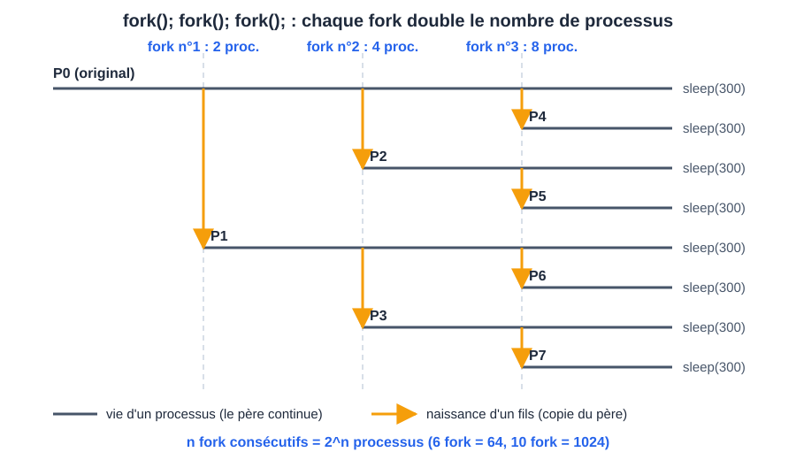

# CM 1 — Les processus

> **Info :** Présent à chaque contrôle (2022-2022, 2022-2023, 2024-2025) : « pourquoi `fork` renvoie 2 valeurs », « combien de processus crée ce code » (n fork = 2^n), « zombie / orphelin / daemon », modes user/kernel, état d'un processus bloqué, lecture d'un code père/fils.

## À savoir faire
- Définir un Processus, son PID et son PPID, le mode user et le mode kernel, un appel système.
- Écrire de mémoire le squelette de `fork` : cas `-1` / `0` / `> 0`.
- **Compter** les processus créés par n `fork` (2^n) et dessiner l'arbre.
- Distinguer Zombie, Orphelin et daemon : qui est vivant, qui est mort.
- Synchroniser père et fils avec `wait` / `waitpid` et lire le code de sortie.
- Dire ce que le fils hérite ou non (Héritage père-fils).

## L'essentiel

### 1. Qu'est-ce qu'un processus ?
- **Programme** = fichier inerte (la recette). **Processus** = ce programme **en train de s'exécuter**. Un même programme peut donner plusieurs processus.
- Un processus = code + données (globales, tas, pile) + **contexte** (registres, compteur ordinal, entrée dans la table des processus du noyau).
- Il a un **PID** unique ; son **PPID** est le PID de son père. Le processus 1 (`init` / `systemd`) est l'ancêtre de tous. On les voit avec `ps` ou `pstree -p`.

| Mode | Qui | Comment on y passe |
|---|---|---|
| user | nos programmes (espace mémoire restreint) | — |
| kernel | le noyau (accès au matériel) | uniquement par un **appel système** (`fork`, `read`, `write`...) |

> **Attention :** `sqrt(64)` est un calcul de bibliothèque en mode user, sans appel système ; `printf` finit par l'appel système `write`.

### 2. États et ordonnancement
- États vus par `ps` : **R** actif, **S** endormi (réveillable), **D** endormi non interruptible, **T** stoppé, **Z** zombie.
- Un processus qui attend une entrée/sortie (clavier, `getchar`, `sleep`) est **bloqué** (`S`) : il ne consomme pas de processeur.
- L'ordonnanceur distribue le processeur par **quantum**, il est préemptif. Conséquence : **on ne peut pas prévoir qui s'exécute en premier** après un `fork`.
- `/proc` est un pseudo-système de fichiers, image du noyau en mémoire : fichiers de **taille 0** (rien sur disque).

### 3. `fork` : un appel, deux retours
`fork()` **duplique** le processus appelant ; le fils reprend juste après le `fork`.

```c
pid_t pid = fork();
if (pid == -1)      { perror("fork"); exit(1); }              // échec, pas de fils
else if (pid == 0)  { /* code du fils */ exit(0); }           // exit : sinon le fils continue le code du père
else                { /* code du père, pid = PID du fils */ }
```

| Retour de `fork` | Qui le reçoit |
|---|---|
| `> 0` (PID du fils) | le père |
| `0` | le fils |
| `-1` | le père (erreur) |

**Pourquoi deux valeurs ?** Le processus est copié : l'appel retourne dans le père **et** dans le fils, avec une valeur différente pour qu'ils sachent qui est qui.

### 4. Compter les processus (question d'examen sûre)
Chaque `fork` fait se dédoubler **tous** les processus existants (fils compris) : **n fork consécutifs = 2^n processus**, père inclus.



- `fork(); fork(); fork(); fork();` → **16** processus (15 créés). Trois fork : 8, six : 64, dix : 1024.
- Pour obtenir exactement N processus, **seul le père** doit créer : `for (i = 0; i < N-1; i++) if (fork() == 0) break;`.

> **Astuce :** On ne devine pas l'ordre d'affichage père/fils. Seul `wait` impose un ordre ; `sleep` n'est qu'un hack d'expérimentation.

**À toi de jouer — combien de processus ?** Trois `fork` de suite (les nœuds verts sont les processus qui viennent d'être créés)
```pas-a-pas
{
  "titre": "fork(); fork(); fork(); : l'arbre des processus",
  "code": [
    "fork();",
    "fork();",
    "fork();",
    "printf(\"Salut\\n\");"
  ],
  "etapes": [
    {"ligne":null,"vars":{"processus":1},"note":"Au départ, un seul processus : A, le père.","schema":{"type":"arbre","noeuds":[{"v":"A"}],"visites":[]}},
    {"ligne":0,"vars":{"processus":2},"note":"Premier fork : A se duplique, B naît. Le fils reprend juste après le fork.","schema":{"type":"arbre","noeuds":[{"v":"A","fils":[1]},{"v":"B"}],"visites":[1]}},
    {"ligne":1,"vars":{"processus":4},"note":"Deuxième fork : il est exécuté par TOUS les processus existants, fils compris. A crée C, B crée D. On passe à 4, pas à 3.","schema":{"type":"arbre","noeuds":[{"v":"A","fils":[1,2]},{"v":"B","fils":[3]},{"v":"C"},{"v":"D"}],"visites":[2,3]}},
    {"ligne":2,"vars":{"processus":8},"note":"Troisième fork : les 4 processus se dédoublent. A crée E, B crée F, C crée G, D crée H. On passe à 8.","schema":{"type":"arbre","noeuds":[{"v":"A","fils":[1,2,4]},{"v":"B","fils":[3,5]},{"v":"C","fils":[6]},{"v":"D","fils":[7]},{"v":"E"},{"v":"F"},{"v":"G"},{"v":"H"}],"visites":[4,5,6,7]}},
    {"ligne":3,"vars":{"Salut affichés":8},"note":"Les 8 processus exécutent le printf : « Salut » s'affiche 8 fois, dans un ordre imprévisible. n fork consécutifs donnent 2^n processus, père inclus.","schema":{"type":"arbre","noeuds":[{"v":"A","fils":[1,2,4]},{"v":"B","fils":[3,5]},{"v":"C","fils":[6]},{"v":"D","fils":[7]},{"v":"E"},{"v":"F"},{"v":"G"},{"v":"H"}],"visites":[0,1,2,3,4,5,6,7]}}
  ]
}
```

### 5. Fin de vie : `exit`, `wait`, zombie, orphelin
- `exit(n)` termine le processus avec un code (0 = succès) ; `return n` dans `main` équivaut à `exit(n)`. `_exit(n)` est l'appel système brut : il ne vide pas les tampons.
- `wait(&status)` **bloque le père jusqu'à la mort d'un fils** et récupère son code ; `waitpid(pid, &status, 0)` attend le fils `pid`. Un appel = un fils : pour N fils, N appels.
- Le code se lit avec `WIFEXITED(status)` puis `WEXITSTATUS(status)`, jamais directement.

| | Fils | Père | Symptôme `ps` |
|---|---|---|---|
| Zombie | **mort** (code non lu) | vivant, ne fait pas `wait` | `Z`, `<defunct>` |
| Orphelin | **vivant** | mort | PPID = 1 (adopté par `init`) |
| Daemon | vivant, détaché volontairement | — | pas de terminal |

- Un zombie ne se tue pas (il est déjà mort) : il disparaît quand le père fait `wait` ou meurt. Il ne garde que son entrée dans la table des processus (code de retour, PID...) ; trop de zombies saturent cette table.
- Un daemon est un service de fond (`sshd`, `cron`), pérenne ; un zombie est éphémère.
- Exemple d'annale 2022-2023 : le fils affiche son PID et son PPID puis dort 1 h ; le père dort 5 s, affiche, et se termine sans `wait`. Pendant la première seconde, les deux sont endormis (`S`) ; après 5 s le fils est **orphelin**, adopté par `init`.

### 6. Héritage père-fils
- Le fils reçoit une **copie** de la mémoire du père : après le `fork`, modifier une variable dans le fils ne change pas celle du père.
- Il reçoit aussi les **descripteurs de fichiers** ouverts, qui pointent vers la même description de fichier : le décalage de lecture/écriture est **partagé**.
- **Non hérités** : son PID et son PPID (nouveaux), les signaux en attente, les verrous de fichiers.

### 7. Pour aller plus loin
- `system("cmd")` lance une commande via le shell et attend sa fin (fonction de bibliothèque).
- `exec*` remplace le programme du processus courant (même PID) ; il ne retourne qu'en cas d'échec. Lancer un autre programme : `fork` puis `exec` dans le fils.
- `vfork` : fils sans copie de mémoire, père suspendu ; le fils termine par `_exit`.

## Erreurs classiques
- Oublier le cas `-1` de `fork`.
- Compter faux : les fils font aussi les `fork` suivants (3 fork = 8, pas 4).
- Fils sans `exit` : il continue dans le code du père et refait des `fork`.
- Confondre zombie (fils mort) et orphelin (père mort).
- Dire que le fils reçoit « le PID du père » de `fork` : il reçoit 0.

## Questions de vérification
1. Pourquoi `fork` est-il appelé une fois et retourne-t-il deux fois ?
2. Combien de processus après `fork(); fork(); fork();` ? Dessiner l'arbre.
3. Un fils meurt, le père dort 1 h sans `wait` : quel état pour le fils ?
4. Le père meurt avant le fils : quel est ensuite le PPID du fils ?
5. Comment obtenir exactement 10 processus ?
