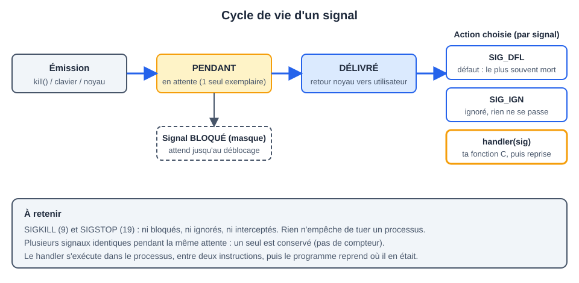

# CM 2 — Les signaux

> **Info :** À retenir pour l'examen : un signal est une alerte **asynchrone** sans données ; un processus choisit entre *défaut / ignorer / handler* ; on installe un handler avec `sigaction` ; `kill` envoie, `pause` / `sigsuspend` attend.
> Annales : 2022-2022 (Q2 asynchrone, tube cassé), 2022-2023 (Q7 handler sur Ctrl-C, SIGPIPE), 2024-2025 (Q8 prise en compte, Q9 SIGCHLD, Q11 et ex. 2.2 SIGSEGV, ex. 2.1 Ctrl-C et `&`).

## À savoir faire
- Définir un Signal et citer 5 signaux (SIGINT, SIGKILL, SIGSEGV, SIGFPE, SIGCHLD).
- Expliquer les 3 réactions possibles : `SIG_DFL`, `SIG_IGN`, Handler.
- Envoyer un signal avec `kill` (et savoir que ça ne « tue » pas forcément).
- Installer un handler avec `sigaction` (et dire pourquoi pas `signal`).
- Expliquer pourquoi `SIGKILL` et `SIGSTOP` sont intouchables.
- Attendre un signal : `pause` et `sigsuspend`, et pourquoi `pause` seul est fragile.
- Bloquer un signal avec un Masque de signaux.

## L'essentiel

### 1. Qu'est-ce qu'un signal ?
- Un **événement asynchrone** envoyé à un processus (comme une interruption logicielle) : il peut arriver à tout moment, indépendamment de l'instruction en cours ; l'émetteur n'attend pas.
- Il ne transporte **aucune donnée** : seulement son numéro. Ce n'est **pas** un moyen de communication, juste de prévenir.
- Émetteur : le **noyau** (division par 0, accès mémoire invalide, fils terminé), le **clavier** (Ctrl-C) ou un **autre processus** (`kill`).
- Linux : signaux 1 à 31 = classiques ; 34 à 64 = temps réel (hors programme). `kill -l` les liste.



### 2. Trois états, trois réactions
| Mot | Sens |
|---|---|
| **pendant** | envoyé mais pas encore pris en compte. **Un seul** exemplaire par type : le suivant est perdu |
| **délivré** | pris en compte, au retour du mode noyau vers le mode utilisateur (quand l'ordonnanceur redonne la main au processus) |
| **bloqué / masqué** | on diffère volontairement la délivrance ; le signal reste pendant |

Réaction du processus à un signal délivré :
1. `SIG_DFL` : action par défaut (souvent : mourir). C'est ce qui se passe si on ne fait rien.
2. `SIG_IGN` : ignorer.
3. un **handler** : une fonction `void f(int sig)`.

> **Attention :** `SIGKILL` (9) et `SIGSTOP` (19) ne s'interceptent, ne s'ignorent et ne se bloquent jamais : aucun programme ne peut être rendu incassable. `sigaction` échoue dessus (retour -1).

### 3. Les signaux à connaître
| Signal | N° | Cause | Défaut |
|---|---|---|---|
| `SIGINT` | 2 | Ctrl-C | terminer |
| `SIGQUIT` | 3 | Ctrl-\ | terminer |
| `SIGFPE` | 8 | division entière par 0 | terminer |
| `SIGKILL` | 9 | `kill -9` | tuer (non interceptable) |
| `SIGUSR1` / `SIGUSR2` | 10 / 12 | libres pour le programmeur | terminer |
| `SIGSEGV` | 11 | accès mémoire invalide | terminer |
| `SIGPIPE` | 13 | écriture dans un tube sans lecteur | terminer |
| `SIGALRM` | 14 | fin d'`alarm()` | terminer |
| `SIGTERM` | 15 | `kill` sans option (demande polie) | terminer |
| `SIGCHLD` | 17 | un fils s'est terminé | ignoré |
| `SIGCONT` / `SIGSTOP` | 18 / 19 | reprendre / suspendre | — |

Cas particuliers :
- **`SIGINT`** : Ctrl-C envoie `SIGINT` au groupe de processus du **premier plan** (annale 2024-2025, ex. 2.1). Un programme lancé avec `&` est en arrière-plan : Ctrl-C ne le vise pas, on l'arrête par `kill PID`.
- **`SIGCHLD`** : envoyé au père quand un fils se termine ; le fils reste **zombie** tant que le père n'a pas fait `wait`. Plusieurs fils morts en même temps = un seul `SIGCHLD` pendant : on boucle sur `waitpid(-1, NULL, WNOHANG)`. Il est aussi envoyé pour les fils créés par `system()`.
- **`SIGPIPE`** : écriture dans un tube dont plus aucun lecteur n'existe. Le fils est tué par défaut ; si le signal est ignoré (`SIG_IGN`) ou capté, `write` retourne `-1` avec `errno = EPIPE` (annales 2022-2022 et 2022-2023).
- **`SIGFPE` / `SIGSEGV`** : envoyés par le noyau à cause d'une instruction fautive. Si le handler fait `return`, l'instruction fautive est **réexécutée** : boucle infinie. Un handler de `SIGSEGV` ne « répare » rien : il peut seulement afficher un message et quitter, ou sauter ailleurs avec `siglongjmp` (annale 2024-2025, Q11 et ex. 2.2). Dans un programme à threads, le signal vise le processus entier.

### 4. Récapitulatif des appels système
| Appel | Rôle | Retour | Piège |
|---|---|---|---|
| `kill(pid, sig)` | envoie `sig` à `pid` | 0 ou -1 | `pid>0` un processus ; `0` son groupe ; `-1` tous (sauf init) ; `<-1` le groupe `-pid`. Le nom est trompeur |
| `signal(sig, f)` | installe `f` (simple) | ancien handler ou `SIG_ERR` | comportement variable selon l'Unix : **déconseillé** |
| `sigaction(sig, &act, &old)` | installe un handler (fiable, POSIX) | 0 ou -1 | impossible sur `SIGKILL` / `SIGSTOP` |
| `sigprocmask(how, &set, &old)` | change le masque des signaux bloqués | 0 ou -1 | `how` = `SIG_BLOCK`, `SIG_UNBLOCK`, `SIG_SETMASK` |
| `sigemptyset` / `sigfillset` / `sigaddset` / `sigdelset` / `sigismember` | construisent un `sigset_t` | 0 / 1 | initialiser le set avant usage |
| `pause()` | dort jusqu'à un signal | toujours -1, `errno=EINTR` | ne dit pas lequel ; **race** possible |
| `sigsuspend(&mask)` | met le masque et dort **atomiquement** | toujours -1, `errno=EINTR` | la solution propre à « bloquer puis attendre » |
| `alarm(n)` | envoie `SIGALRM` dans n secondes | secondes restantes | sans handler, tue le processus |
| `raise(sig)` | s'envoie un signal | 0 ou ≠0 | = `kill(getpid(), sig)` |

Shell : `kill PID` envoie `SIGTERM` (15), `kill -9 PID` envoie `SIGKILL` (dernier recours, sans nettoyage), `kill -l` liste les signaux. On ne peut envoyer qu'à ses propres processus (sauf root). `kill(pid, 0)` n'envoie rien : teste seulement l'existence.

### 5. `sigaction` en 4 lignes
```c
struct sigaction act;
act.sa_handler = mon_handler;   // la fonction à lancer (void f(int))
sigemptyset(&act.sa_mask);      // signaux à bloquer EN PLUS pendant le handler
act.sa_flags = 0;               // options (SA_RESETHAND, SA_RESTART...)
sigaction(SIGINT, &act, NULL);  // installe ; NULL = on ne sauvegarde pas l'ancien
```
- Le signal qui déclenche le handler est **automatiquement bloqué** pendant le handler.
- Le handler s'exécute **entre deux instructions** du programme, puis le programme **reprend où il était**.
- `SA_RESETHAND` : le handler ne sert **qu'une fois**, ensuite retour à `SIG_DFL`. Sans ce flag, le handler reste installé.
- Oublier `sigemptyset(&act.sa_mask)` laisse un masque aléatoire.

### 6. Masque de signaux
- Le **masque** est l'ensemble des signaux bloqués. Un signal bloqué n'est pas perdu : il reste **pendant** jusqu'au déblocage, puis il est délivré.
- Le masque est hérité par le fils (`fork`). `SIGKILL` et `SIGSTOP` ne se bloquent pas.
```c
sigset_t s;
sigemptyset(&s); sigaddset(&s, SIGINT);
sigprocmask(SIG_BLOCK, &s, NULL);   // Ctrl-C est mis en attente
/* section critique */
sigprocmask(SIG_UNBLOCK, &s, NULL); // le Ctrl-C en attente est délivré maintenant
```

### 7. Dans un handler
- Peu de choses sont autorisées : `write`, `_exit`, modifier un `volatile sig_atomic_t`. Éviter `printf` et `malloc`.
- Raison : une Fonction réentrante ne doit pas utiliser de variable globale ou `static`, ni appeler `malloc`, `printf`… Un handler peut interrompre ces appels.

## Exemple minimal (à savoir refaire)
Un programme qui réagit au Ctrl-C une fois, puis meurt au second.
```c
#include <stdio.h>
#include <signal.h>
#include <unistd.h>

void ouille(int sig) {                  // le handler : reçoit le n° du signal
    write(1, "OUILLE !\n", 9);          // write plutôt que printf
}

int main(void) {
    struct sigaction act;
    act.sa_handler = ouille;
    sigemptyset(&act.sa_mask);
    act.sa_flags = SA_RESETHAND;        // 2e Ctrl-C : comportement par défaut (mort)
    sigaction(SIGINT, &act, NULL);

    while (1) { printf("Hello\n"); sleep(1); }
}
```

### Attendre proprement un signal (père attend son fils)
```c
sigset_t bloque, vide;
sigemptyset(&bloque); sigaddset(&bloque, SIGUSR1);
sigprocmask(SIG_BLOCK, &bloque, NULL);  // 1. on bloque AVANT que le signal puisse arriver
/* ... fork, etc. ... */
sigemptyset(&vide);                     // masque vide = « tout autorisé »
sigsuspend(&vide);                      // 2. débloque ET dort en une seule opération atomique
```
Pourquoi : avec `pause()` après un test (`while(!recu) pause();`), le signal peut arriver **entre** le test et le `pause` : on dort pour toujours. De même, `sleep(1)` pour synchroniser un père et un fils réduit la probabilité de la course sans la supprimer : le handler doit être installé et le signal bloqué **avant** le `fork`.

## Erreurs classiques
- Croire que `kill` tue : il **envoie** un signal ; c'est la réaction qui décide.
- Utiliser `signal()` partout : variable d'un Unix à l'autre. Préférer `sigaction`.
- Mettre `printf` (ou `malloc`) dans un handler : non sûr ; préférer `write` et un drapeau `volatile sig_atomic_t`.
- Compter sur plusieurs signaux identiques : s'ils arrivent pendant qu'un est pendant, **un seul** est vu.
- Handler installé **après** `fork` dans le fils : le père peut envoyer le signal avant. Installer **avant** le `fork`.
- Handler de `SIGFPE` / `SIGSEGV` qui retourne : boucle infinie.
- Oublier que `SIGCHLD` arrive aussi pour les fils créés par `system()`.

## Questions de vérification
1. Quel signal reçoit un processus qui divise un entier par 0 ? Qui l'envoie ?
2. Que signifie `kill(0, SIGTERM)` ? et `kill(-1, SIGTERM)` ?
3. Pourquoi un handler lancé par `SIGINT` n'est-il pas interrompu par un autre `SIGINT` ?
4. Pourquoi `while(!recu) pause();` est-il incorrect ? Comment corriger ?
5. Un fils termine : quel signal le père reçoit-il, et que doit-il faire ensuite ?
6. Quand un signal envoyé à P2 par P1 est-il pris en compte ? Et s'il est masqué ?
