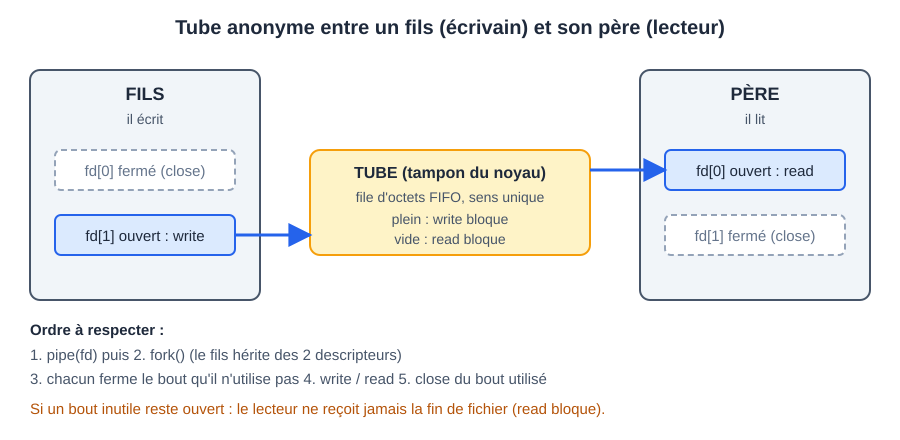

# CM 3 — Communication interprocessus : les tubes

> **Info :** Annales 2022-2022 (ex. 2.1), 2022-2023 (ex. 2.2) et 2024-2025 (Q6) : tube nommé entre deux processus sans parenté, tube anonyme père-fils (`pipe` avant `fork`), `SIGPIPE`, blocage de `read`/`write`.

## À savoir faire
- Expliquer pourquoi le père et le fils ne communiquent pas par variable : mémoires séparées après `fork`.
- Écrire de tête : `pipe` → `fork` → chacun ferme son bout inutile → `write`/`read` → `close`.
- Prédire quand `read`/`write` bloquent, et quand `read` rend 0.
- Faire une communication dans les deux sens (2 tubes).
- Rediriger `stdin`/`stdout` sur un tube avec `dup2` puis `exec` (reproduire `ls | wc -l`).
- Différencier tube anonyme, tube nommé (FIFO) et mémoire partagée.

## L'essentiel

### 1. Les moyens de communication
| Outil | Lien entre processus | Où ? |
|---|---|---|
| Tube anonyme | parenté (père, fils, frères) | une machine |
| Tube nommé (FIFO) | aucun, il suffit de connaître le nom | une machine |
| Mémoire partagée | aucun (par clé) | une machine, très rapide, synchronisation à faire soi-même |
| Sockets | aucun | machines distantes (autre cours) |

Un code de sortie (`exit`/`wait`) est trop pauvre : il faut un vrai canal.

### 2. Descripteurs : le rappel utile
- Un descripteur est un entier qui désigne une entrée-sortie ouverte (fichier, tube, socket, terminal). `0` = `STDIN`, `1` = `STDOUT`, `2` = `STDERR`.
- `open`, `pipe`, `dup` rendent toujours le plus petit numéro libre : avec 0, 1, 2 déjà pris, deux fichiers ouverts donnent 3 et 4 (annale 2024-2025).
- `read(fd, buf, n)` lit jusqu'à `n` octets (rend le nombre lu, 0 = fin, -1 = erreur). `write(fd, buf, n)` écrit `n` octets (rend le nombre écrit, -1 = erreur).
- Les descripteurs sont hérités par `fork` et conservés par `exec`.

### 3. Le tube anonyme
- Un tube est une file d'octets FIFO à sens unique, dans un tampon du noyau. On écrit d'un côté, on lit de l'autre, dans l'ordre.
- `pipe(fd)` remplit un tableau de 2 entiers : `fd[0]` = lecture, `fd[1]` = écriture.
- Il n'a pas de nom : seuls les processus qui ont hérité des descripteurs (via `fork`) y accèdent. D'où : créer le tube **avant** le `fork`. Sinon chaque processus a son propre tube et rien ne passe (annale 2022-2023).
- La lecture est destructive : un octet lu ne peut pas être relu.
- Le sens est figé. Pour deux sens, il faut deux tubes.



**Règles de blocage (à connaître par cœur)**
| Situation | Résultat |
|---|---|
| `read` sur tube vide, des écrivains existent encore | bloque |
| `read` sur tube vide, plus aucun descripteur d'écriture ouvert | rend 0 (fin de fichier) |
| `write` sur tube plein | bloque |
| `write` sans aucun lecteur | signal `SIGPIPE` (le processus meurt par défaut) |

C'est ce qui rend les tubes synchrones, alors que les signaux sont asynchrones (annale 2024-2025 Q6).

> **Info :** Capacité du tampon : finie (environ 64 Ko sous Linux). Retenir : plein = écrivain bloqué. Le tube n'occupe aucun espace disque : taille 0 dans le système de fichiers, les données transitent par la mémoire du noyau (annales 2022-2022 Q8 et 2022-2023 Q9).

**Qui crée le tube ?** Le noyau, à la demande du processus par un appel système (`pipe` ou `mkfifo`) : en mode utilisateur on ne peut pas allouer de mémoire noyau (annale 2022-2023).

### 4. Récapitulatif des appels
| Appel | Rôle | Piège |
|---|---|---|
| `pipe(int fd[2])` | crée un tube anonyme | à faire avant `fork` ; `fd[0]` lit, `fd[1]` écrit |
| `fork()` | duplique le processus, hérite des fd | les deux processus ont les deux bouts ouverts |
| `close(fd)` | ferme un descripteur | oublier un bout : la lecture ne rend jamais 0 |
| `read(fd, buf, n)` | lit dans le tube | pas de `\0` ajouté ; peut lire moins que `n` |
| `write(fd, buf, n)` | écrit dans le tube | `SIGPIPE` si plus de lecteur |
| `dup2(old, new)` | `new` devient une copie de `old` (ferme `new` d'abord) | fermer ensuite l'original |
| `mkfifo(chemin, mode)` | crée un tube nommé | `open` bloque tant que l'autre bout n'est pas ouvert |
| `unlink(chemin)` | supprime le FIFO | sinon il reste (lettre `p` dans `ls -l`) |
| `waitpid(pid, NULL, 0)` | attend la fin du fils | sans lui le père peut finir avant le fils |

### 5. Le tube nommé (FIFO)
- Même comportement qu'un tube anonyme, mais avec un nom dans le système de fichiers (`p` dans `ls -l`).
- Deux processus sans parenté communiquent : l'un l'ouvre en écriture, l'autre en lecture. C'est LA réponse quand l'énoncé dit « sans lien de parenté » (annales 2022-2022 et 2022-2023).
- Il persiste après la fin des programmes : le supprimer avec `unlink` (ou `rm`). Son `open` bloque jusqu'à ce que l'autre extrémité soit ouverte.
- C'est un fichier : l'accès dépend de ses droits. Avec `0600`, l'`open` d'un autre utilisateur échoue ; avec `0666`, n'importe qui peut écrire (annale 2022-2022).

```text
Écrivain                                   Lecteur
mkfifo("/tmp/tube", 0600)
fd = open("/tmp/tube", O_WRONLY)           fd = open("/tmp/tube", O_RDONLY)
write(fd, message, taille)                 boucle : n = read(fd, buf, taille) jusqu'à n == 0
close(fd) ; unlink("/tmp/tube")            close(fd)
```

### 6. Le signal SIGPIPE
- Envoyé à un processus qui écrit dans un tube dont plus aucun lecteur n'existe. Action par défaut : terminer le processus.
- Cas d'annale (2022-2023) : père et fils ferment tous les deux la sortie du tube, le fils écrit : `SIGPIPE` tue le fils.
- Deux parades : ne pas fermer le bout du lecteur tant qu'il y a un écrivain (chacun ferme seulement le bout qu'il n'utilise pas), et traiter le signal : `signal(SIGPIPE, SIG_IGN)` puis tester le retour de `write` (`-1`, `errno = EPIPE`).

### 7. Redirection avec `dup2` (le cœur de `ls | wc -l`)
Un programme (`ls`) écrit sur `STDOUT`, un autre (`wc`) lit `STDIN`. On branche `STDOUT` du premier sur le bout d'écriture du tube et `STDIN` du second sur le bout de lecture, puis `exec` : les programmes lancés ne savent pas qu'il y a un tube.

- Sortie du fils : `dup2(fd[1], STDOUT_FILENO); close(fd[0]); close(fd[1]);`
- Entrée du père : `dup2(fd[0], STDIN_FILENO); close(fd[0]); close(fd[1]);`
- Version `dup` : `close(1); dup(fd[1]); close(fd[1]);` (`dup` prend le plus petit descripteur libre, donc on ferme d'abord la cible).

### 8. La mémoire partagée (survol)
- Plusieurs processus voient la même zone de RAM. C'est le plus rapide des moyens (pas de copie, pas d'appel système pour lire ou écrire).
- Aucune synchronisation fournie : il faut des sémaphores (compteur protégé par le noyau, `P` bloque si le compteur vaut 0, `V` rend).
- Cycle : `shmget` (créer, clé `ftok`) → `shmat` (attacher, rend un pointeur) → utiliser → `shmdt` (détacher) → `shmctl(IPC_RMID)` (supprimer). `exit` détache mais ne supprime pas.

## Exemple minimal : le fils écrit, le père lit
```c
int fd[2];
pipe(fd);                          // 1. le tube AVANT le fork
if (fork() == 0) {                 // 2. fils = écrivain
    close(fd[0]);                  // ferme le bout lecture
    write(fd[1], "bonjour", 7);
    close(fd[1]);                  // le père verra la fin de fichier
    return 0;
}
close(fd[1]);                      // père = lecteur : ferme le bout écriture
char buf[32];
int n = read(fd[0], buf, sizeof buf - 1);  // bloque tant que le fils n'a pas écrit
buf[n] = '\0';                     // read ne met pas de '\0'
close(fd[0]);
wait(NULL);                        // évite le zombie
```

**À toi de jouer — le fils écrit, le père lit** : l'état des descripteurs à chaque étape (✗ = bout fermé)
```pas-a-pas
{
  "titre": "pipe + fork : le fils écrit « bonjour », le père le lit",
  "code": [
    "int fd[2];",
    "pipe(fd);",
    "if (fork() == 0) {",
    "    close(fd[0]);",
    "    write(fd[1], \"bonjour\", 7);",
    "    close(fd[1]);",
    "    return 0;",
    "}",
    "close(fd[1]);",
    "char buf[32];",
    "int n = read(fd[0], buf, sizeof buf - 1);"
  ],
  "etapes": [
    {"ligne":1,"note":"pipe crée le tube et remplit fd : fd[0] pour lire, fd[1] pour écrire. On le crée avant le fork, sinon le fils n'y aurait pas accès.","schema":{"type":"tube","gauche":{"nom":"Père","lecture":"ouvert","ecriture":"ouvert"},"tampon":""}},
    {"ligne":2,"note":"fork : le fils hérite des deux descripteurs. Les deux processus ont les deux bouts ouverts.","schema":{"type":"tube","gauche":{"nom":"Père","lecture":"ouvert","ecriture":"ouvert"},"droite":{"nom":"Fils","lecture":"ouvert","ecriture":"ouvert"},"tampon":""}},
    {"ligne":3,"note":"Le fils est l'écrivain : il ferme le bout dont il ne se sert pas, la lecture.","schema":{"type":"tube","gauche":{"nom":"Père","lecture":"ouvert","ecriture":"ouvert"},"droite":{"nom":"Fils","lecture":"ferme","ecriture":"ouvert"},"tampon":""}},
    {"ligne":4,"note":"Le fils écrit 7 octets dans le tampon du tube. (L'ordre exact père/fils dépend de l'ordonnanceur ; le read du père bloque tant que rien n'est écrit.)","schema":{"type":"tube","gauche":{"nom":"Père","lecture":"ouvert","ecriture":"ouvert"},"droite":{"nom":"Fils","lecture":"ferme","ecriture":"ouvert"},"tampon":"bonjour"}},
    {"ligne":5,"note":"Le fils ferme son bout d'écriture : il a fini, et c'est ce qui permettra au père de voir la fin de fichier.","schema":{"type":"tube","gauche":{"nom":"Père","lecture":"ouvert","ecriture":"ouvert"},"droite":{"nom":"Fils","lecture":"ferme","ecriture":"ferme"},"tampon":"bonjour"}},
    {"ligne":8,"note":"Le père est le lecteur : il ferme le bout d'écriture. Il ne reste plus aucun descripteur d'écriture ouvert.","schema":{"type":"tube","gauche":{"nom":"Père","lecture":"ouvert","ecriture":"ferme"},"droite":{"nom":"Fils","lecture":"ferme","ecriture":"ferme"},"tampon":"bonjour"}},
    {"ligne":10,"vars":{"n":7},"note":"read récupère « bonjour » : il rend 7. La lecture est destructive, le tube est de nouveau vide. read n'ajoute pas de '\\0'.","schema":{"type":"tube","gauche":{"nom":"Père","lecture":"ouvert","ecriture":"ferme"},"droite":{"nom":"Fils","lecture":"ferme","ecriture":"ferme"},"tampon":""}}
  ]
}
```

**Pourquoi fermer les bouts inutiles ?** La cause numéro 1 des programmes qui restent figés
```pas-a-pas
{
  "titre": "Le père oublie close(fd[1])",
  "code": [
    "pipe(fd) ; fork()",
    "// fils : close(fd[0]) ; write(fd[1], \"bonjour\", 7) ; return 0",
    "// père : close(fd[1]) oublié !",
    "n = read(fd[0], buf, 7)",
    "n = read(fd[0], buf, 7)"
  ],
  "etapes": [
    {"ligne":0,"note":"Le tube est créé avant le fork : les deux processus ont les deux bouts ouverts.","schema":{"type":"tube","gauche":{"nom":"Père","lecture":"ouvert","ecriture":"ouvert"},"droite":{"nom":"Fils","lecture":"ouvert","ecriture":"ouvert"},"tampon":""}},
    {"ligne":1,"note":"Le fils écrit « bonjour » puis termine, en fermant ses deux bouts.","schema":{"type":"tube","gauche":{"nom":"Père","lecture":"ouvert","ecriture":"ouvert"},"droite":{"nom":"Fils","lecture":"ferme","ecriture":"ferme"},"tampon":"bonjour"}},
    {"ligne":3,"vars":{"n":7},"note":"Premier read : il rend 7 (bonjour). Le tube est maintenant vide.","schema":{"type":"tube","gauche":{"nom":"Père","lecture":"ouvert","ecriture":"ouvert"},"droite":{"nom":"Fils","lecture":"ferme","ecriture":"ferme"},"tampon":""}},
    {"ligne":4,"note":"Second read : tube vide. Reste-t-il un descripteur d'écriture ouvert ? Oui, celui du père lui-même (fd[1]). read BLOQUE donc pour toujours : il attend un écrivain qui ne viendra jamais.","schema":{"type":"tube","gauche":{"nom":"Père","lecture":"ouvert","ecriture":"ouvert"},"droite":{"nom":"Fils","lecture":"ferme","ecriture":"ferme"},"tampon":""}},
    {"ligne":2,"vars":{"n":0},"note":"Correction : le père ferme fd[1] avant de lire. Plus aucun écrivain : le read sur tube vide rend 0 (fin de fichier) au lieu de bloquer.","schema":{"type":"tube","gauche":{"nom":"Père","lecture":"ouvert","ecriture":"ferme"},"droite":{"nom":"Fils","lecture":"ferme","ecriture":"ferme"},"tampon":""}}
  ]
}
```

## Exemple minimal : `ls -l | wc -l`
```c
int p[2];
pipe(p);
if (fork() == 0) {                 // fils : ls -l (producteur)
    dup2(p[1], STDOUT_FILENO);     // sa sortie devient le tube
    close(p[0]); close(p[1]);      // les deux originaux ne servent plus
    execlp("ls", "ls", "-l", NULL);
    perror("execlp"); _exit(1);    // atteint seulement si exec a échoué
}
dup2(p[0], STDIN_FILENO);          // père : son entrée devient le tube
close(p[0]); close(p[1]);
execlp("wc", "wc", "-l", NULL);    // le père devient wc
```

**À toi de jouer — `dup2` et la table des descripteurs** du fils qui lance `ls` (`tty` = terminal, `lec` et `écr` = les deux bouts du tube)
```pas-a-pas
{
  "titre": "ls -l | wc -l : la table des descripteurs du fils",
  "code": [
    "int p[2];",
    "pipe(p);",
    "if (fork() == 0) {",
    "    dup2(p[1], STDOUT_FILENO);",
    "    close(p[0]); close(p[1]);",
    "    execlp(\"ls\", \"ls\", \"-l\", NULL);",
    "}"
  ],
  "etapes": [
    {"ligne":1,"vars":{"p[0]":3,"p[1]":4},"note":"La table des descripteurs : les cases 0, 1, 2 sont le terminal. pipe prend les deux plus petits numéros libres : 3 pour lire, 4 pour écrire.","schema":{"type":"tableau","cases":["tty","tty","tty","lec","écr"],"marques":{"p[0]":3,"p[1]":4},"surligne":[3,4]}},
    {"ligne":2,"note":"fork : le fils a une copie de la table. On suit maintenant la table du fils.","schema":{"type":"tableau","cases":["tty","tty","tty","lec","écr"],"marques":{"p[0]":3,"p[1]":4}}},
    {"ligne":3,"note":"dup2(p[1], 1) ferme d'abord le descripteur 1 (le terminal) puis en fait une copie du bout d'écriture : la sortie standard du fils est maintenant le tube.","schema":{"type":"tableau","cases":["tty","écr","tty","lec","écr"],"marques":{"p[0]":3,"p[1]":4},"surligne":[1]}},
    {"ligne":4,"note":"Les deux bouts d'origine ne servent plus : on les ferme, sinon la fin de fichier n'arriverait jamais chez le lecteur.","schema":{"type":"tableau","cases":["tty","écr","tty","–","–"],"marques":{"p[0]":3,"p[1]":4}}},
    {"ligne":5,"note":"execlp conserve les descripteurs : ls écrit sur sa sortie standard (1) sans savoir que c'est un tube. Tout ce qu'il affiche arrive chez wc.","schema":{"type":"tableau","cases":["tty","écr","tty","–","–"],"marques":{"p[0]":3,"p[1]":4},"fixes":[1]}}
  ]
}
```

## Erreurs classiques
- Créer le tube après le `fork` : chaque processus a son tube privé.
- Ne pas fermer les bouts inutiles : un lecteur qui garde `fd[1]` ouvert ne voit jamais la fin de fichier, `read` bloque pour toujours (cause n°1 de programme figé).
- Un seul tube pour dialoguer dans les deux sens : prendre deux tubes.
- Oublier le `'\0'` en affichant ce qu'on a lu ; croire que `read` rend exactement `n` octets (utiliser sa valeur de retour).
- Après `dup2`, oublier de fermer l'original : la fin de fichier n'arrive jamais.
- Ne pas `waitpid` : le père finit avant le fils ou laisse un zombie.
- Tube nommé : oublier `unlink` ; `open` en lecture sans écrivain, on bloque.
- Dire que le tube est sur le disque (sa taille est 0, tout est dans le noyau).

## Questions de vérification
1. Pourquoi une variable globale modifiée par le fils n'est-elle pas vue du père ?
2. Si le père oublie `close(fd[1])` et que le fils termine, que devient le `read` du père ?
3. Écrire `p1 | p2 | p3` : combien de tubes, combien de `fork` ?
4. Pourquoi redirige-t-on `STDOUT`/`STDIN` avant `exec` ?
5. Un FIFO existe sur le disque : contient-il des données sur le disque ?
