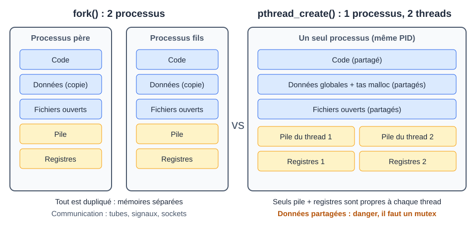

# CM 4 — Les threads

> **Info :** Un exercice « threads » tombe à chaque contrôle terminal (CT 2022-2022, 2022-2023, 2024-2025).
> Questions types : combien de threads, rôle de `pthread_join`, `ps -jfT`, pourquoi l'ordre d'affichage change, fork contre `pthread_create`.

## À savoir faire
- Dire en deux phrases la différence entre processus et thread (ce qui est partagé, ce qui ne l'est pas).
- Écrire de tête un programme minimal : `pthread_create` puis `pthread_join`.
- Passer un paramètre à un thread et récupérer sa valeur de retour (cast `void *`).
- Expliquer pourquoi, sans `join`, le `main` tue tous les threads.
- Repérer une condition de concurrence et la corriger avec un mutex.
- Expliquer pourquoi l'ordre d'affichage change d'une exécution à l'autre (ordonnanceur).
- Compter les threads d'un programme (créés + 1) et lire `ps -jfT` (même PID, SPID différents).

## L'essentiel

### 1. Un thread, c'est quoi
- Un thread est un **fil d'exécution** à l'intérieur d'un processus (« processus léger »).
- Un processus a **toujours au moins 1 thread** (le `main`).
- Tous les threads d'un processus ont le **même PID** et partagent sa mémoire.
- Sur un processeur multi-cœurs, plusieurs threads tournent **vraiment en parallèle**.

| Pourquoi des threads ? | Pourquoi pas ? |
|---|---|
| Création bien plus rapide qu'un `fork` | Bugs difficiles : l'ordre d'exécution change à chaque lancement |
| Partage de données facile (même mémoire) | Il faut protéger les variables partagées |
| Utilise tous les cœurs (calcul, serveur, interface) | Si un thread plante (SIGSEGV), **tout le processus** meurt |

### 2. Processus contre threads



| | `fork()` : processus | `pthread_create()` : thread |
|---|---|---|
| Mémoire | **copiée**, indépendante | **partagée** (globales, tas) |
| Propre à chacun | tout | **pile + registres** seulement |
| Communication | tubes, signaux, sockets | simplement une variable globale |
| Coût de création | élevé | faible |
| Le nouveau démarre | après le `fork`, en copie du père | au début de la **fonction** passée |

Exemple avec une globale `i = 0` :
- **Processus** : le père fait `i += 1000`, le fils fait `i += 10` : chacun voit **sa** valeur. Résultat toujours le même.
- **Thread** : les deux modifient **le même** `i` : le résultat dépend de qui passe en premier. C'est le rôle du mutex.

### 3. L'API pthread
Compiler avec `gcc prog.c -o prog -pthread`. Sans l'option : erreur de lien `référence indéfinie vers pthread_create`.

| Appel | Rôle | Retour | Piège |
|---|---|---|---|
| `pthread_create(&tid, NULL, f, arg)` | lance un thread qui exécute `f(arg)` | 0 si OK, **code d'erreur** sinon (pas `-1`) | `f` doit être `void *f(void *)` ; `arg` doit **vivre** aussi longtemps que le thread |
| `pthread_join(tid, &ret)` | attend la fin du thread, récupère son retour | 0 si OK | Sans `join`, si `main` finit, **tous les threads sont tués** |
| `pthread_exit(val)` | termine **le thread appelant** | ne revient pas | Ne pas confondre avec `exit()` qui tue **tout le processus** |
| `pthread_self()` | identifiant du thread courant | `pthread_t` | Ce n'est pas le PID |
| `pthread_mutex_init/lock/unlock/destroy` | verrou d'exclusion mutuelle | 0 si OK | Oublier `unlock` = blocage |

Tous les threads ont le **même `getpid()`**. Le noyau voit un identifiant par thread (colonne `SPID` de `ps -jfT`).

### 4. Exemple minimal
```c
#include <stdio.h>
#include <pthread.h>

// Fonction du thread : signature OBLIGATOIRE void *f(void *)
void *activite(void *arg) {
    int n = *(int *)arg;          // arg est un void * : on le caste puis on déréférence
    printf("thread : j'ai reçu %d\n", n);
    return NULL;                  // valeur de retour (récupérable par join)
}

int main(void) {
    pthread_t t;
    int valeur = 42;              // doit rester valide tant que le thread tourne
    pthread_create(&t, NULL, activite, &valeur);  // NULL = attributs par défaut
    pthread_join(t, NULL);        // main attend la fin du thread
    return 0;
}
```

> **Astuce :** `void *(*)(void *)` se lit « pointeur vers une fonction qui prend un `void *` et rend un `void *` ». Retenir : la fonction du thread **prend 1 `void *` et rend 1 `void *`**.

### 5. Plusieurs paramètres : une structure
```c
struct data { const char *id; int n; };

void *tache(void *p_data) {
    struct data *p = p_data;                 // on retrouve le bon type
    for (int i = 0; i < p->n; i++)
        printf("Hello %s (%d)\n", p->id, i);
    return NULL;
}
// main : struct data a = {"A", 5}; pthread_create(&ta, NULL, tache, &a);
```
On passe l'**adresse** d'une structure qui reste vivante (variable de `main` ou `malloc`, **jamais** une variable locale qui disparaît).

### 6. Récupérer une valeur de retour
```c
void *neg(void *param) {
    int *r = malloc(sizeof(int));   // sur le TAS : survit à la fin du thread
    *r = -*(int *)param;
    return r;
}
// main :
int *res;
pthread_join(t, (void **)&res);     // res reçoit l'adresse renvoyée
printf("%d\n", *res);
free(res);
```
> **Attention :** ne jamais renvoyer l'adresse d'une variable locale du thread (sa pile disparaît). Soit `malloc` (puis `free` dans `main`), soit un entier casté en `void *`.

### 7. `join` est indispensable
| Situation | Conséquence |
|---|---|
| `main` finit avant les threads, pas de `join` | **tout est tué**, parfois aucun affichage |
| un thread appelle `exit(1)` | **tout le processus** s'arrête |
| un thread fait `return` ou `pthread_exit` | seul ce thread s'arrête |

`pthread_join` est au thread ce que `wait` est au processus fils. Il attend ; il ne force pas l'ordre d'exécution des threads.

### 8. Données partagées, section critique, mutex
Deux threads font `compteur += 1` sur la même variable : l'ordonnanceur peut les **interrompre à tout moment**, même au milieu de l'opération (lire, ajouter, écrire). Exemple du cours : le thread 1 est coupé, le thread 2 incrémente, et « thread 2 terminé » s'affiche **deux fois**.

- **Section critique** : portion de code qui touche une ressource partagée.
- **Exclusion mutuelle** : un seul thread à la fois dans la section critique.
- **Condition de concurrence** : résultat qui dépend de l'ordre d'exécution (change d'une exécution à l'autre, peut être faux).

```c
pthread_mutex_t lock;                 // global, partagé par tous les threads

void *travail(void *arg) {
    pthread_mutex_lock(&lock);        // les autres attendent ici
    compteur += 1;                    // section critique
    printf("thread %d\n", compteur);
    pthread_mutex_unlock(&lock);      // un autre thread peut entrer
    return NULL;
}
// main : pthread_mutex_init(&lock, NULL); ... join ... pthread_mutex_destroy(&lock);
```

**À toi de jouer — pourquoi il faut un mutex** : deux threads font `compteur += 1` sur la même variable (au départ `compteur = 0`)
```pas-a-pas
{
  "titre": "compteur += 1 sans mutex : un incrément est perdu",
  "code": [
    "compteur += 1;     // en réalité, trois étapes :",
    "  tmp = compteur;  // 1. lire",
    "  tmp = tmp + 1;   // 2. ajouter",
    "  compteur = tmp;  // 3. écrire"
  ],
  "etapes": [
    {"ligne":0,"vars":{"compteur":0},"note":"Les deux threads (T1 et T2) vont exécuter cette ligne. Elle semble s'exécuter d'un bloc, mais en réalité elle comporte trois étapes qu'on peut interrompre."},
    {"ligne":1,"vars":{"tmp de T1":0},"note":"T1 lit compteur : il vaut 0."},
    {"ligne":1,"vars":{"tmp de T2":0},"note":"L'ordonnanceur interrompt T1 au milieu de l'opération et donne la main à T2, qui lit à son tour : 0 aussi."},
    {"ligne":2,"vars":{"tmp de T2":1},"note":"T2 ajoute 1 dans son tmp."},
    {"ligne":3,"vars":{"compteur":1},"note":"T2 écrit : compteur vaut 1."},
    {"ligne":2,"vars":{"tmp de T1":1},"note":"T1 reprend là où il s'était arrêté, avec son ancien tmp (0) : il ajoute 1."},
    {"ligne":3,"vars":{"compteur":1},"note":"T1 écrit : compteur vaut 1. Deux incréments, résultat 1 au lieu de 2 : c'est une condition de concurrence. Le résultat change d'une exécution à l'autre."}
  ]
}
```

**La même chose avec un mutex** : la section critique est exécutée par un seul thread à la fois
```pas-a-pas
{
  "titre": "compteur += 1 protégé par un mutex",
  "code": [
    "pthread_mutex_lock(&lock);",
    "compteur += 1;     // section critique",
    "pthread_mutex_unlock(&lock);"
  ],
  "etapes": [
    {"ligne":0,"vars":{"compteur":0,"verrou":"pris par T1"},"note":"T1 prend le verrou et entre dans la section critique."},
    {"ligne":0,"vars":{"verrou":"pris par T1, T2 attend"},"note":"T2 arrive au lock : le verrou est pris, T2 est bloqué ici. Même si l'ordonnanceur lui donne la main, il ne passe pas."},
    {"ligne":1,"vars":{"compteur":1},"note":"T1 fait son incrément en entier, sans que T2 puisse s'intercaler : compteur vaut 1."},
    {"ligne":2,"vars":{"verrou":"pris par T2"},"note":"T1 libère le verrou : T2 peut entrer."},
    {"ligne":1,"vars":{"compteur":2},"note":"T2 fait son incrément : compteur vaut 2, le résultat attendu."},
    {"ligne":2,"vars":{"verrou":"libre"},"note":"T2 libère à son tour. Le mutex rend le code correct mais plus lent : la section critique doit être la plus courte possible."}
  ]
}
```
- Le mutex rend le code **correct mais plus lent** : section critique la plus courte possible.
- Il protège aussi contre l'accès concurrent à des fonctions **non réentrantes** (`malloc`, `printf`).
- Un mutex local à chaque thread est inutile : il doit être **partagé**.
- Sémaphore (à connaître en définition) : compteur autorisant N accès simultanés ; P (`sem_wait`) décrémente et bloque à 0, V (`sem_post`) incrémente et réveille. Un mutex est un sémaphore binaire.

### 9. Threads et signaux
- Un signal est envoyé au **processus** ; un thread qui ne le **masque** pas le traite.
- Une faute (SIGSEGV, SIGFPE) tue **tout le processus**, pas seulement le thread fautif.
- Chaque thread a son **masque** (`pthread_sigmask`), hérité à la création.
- `pthread_kill(tid, sig)` envoie un signal à un thread précis.
- Bonne pratique : un **thread dédié** boucle sur `sigwait()` ; les autres masquent les signaux.

### 10. Type examen : N threads de calcul
```c
#define N 4
void *carre(void *arg) {
    int v = *(int *)arg;
    int *r = malloc(sizeof(int));
    *r = v * v;
    return r;
}
int main(void) {
    pthread_t t[N]; int data[N] = {2, 3, 4, 5}; int total = 0;
    for (int i = 0; i < N; i++)                      // 1) on lance TOUS les threads
        pthread_create(&t[i], NULL, carre, &data[i]);
    for (int i = 0; i < N; i++) {                    // 2) puis on les attend un par un
        int *r; pthread_join(t[i], (void **)&r);
        total += *r; free(r);
    }
    printf("total = %d\n", total);
}
```
Deux boucles : avec `create` puis `join` dans la même boucle, on attendrait chaque thread avant de lancer le suivant, donc plus de parallélisme.

## Ce que disent les annales
- **Combien de threads ?** Compter les `pthread_create` **+ 1** pour le thread principal (4 créés : 5 threads ; 2 créés : 3 threads). Réponse « 4 » = oubli classique.
- **Fonction du thread principal pour attendre 4 threads** : `pthread_join`, 4 fois (une par thread). Sinon `main` se termine, ce qui termine le processus et tue les threads.
- **`ps -jfT`** (une ligne par thread) : les lignes `./thread` ont le même PID et des SPID différents : un seul processus à plusieurs threads.
- **Processus ou threads ?** Processus : espace d'adressage propre (copie au `fork`). Threads : mémoire partagée, un thread peut corrompre les autres, d'où la synchronisation ; seuls pile et compteur ordinal sont propres.
- **Intérêt de `fork` / `pthread_create`** : plusieurs tâches en même temps, grâce aux multi-cœurs et à l'ordonnanceur ; `fork` copie la mémoire (isolation), `pthread_create` la partage (plus léger, synchronisation nécessaire).
- **Ordre d'affichage différent à chaque exécution** (10 threads en Rust, 2024-2025) : l'ordonnanceur décide, ce n'est pas déterministe. Le `join` évite que `main` se termine avant les threads.

## Erreurs classiques
| Erreur | Effet | Correction |
|---|---|---|
| Oublier `-pthread` | erreur de lien | `gcc ... -pthread` |
| Pas de `join` | `main` quitte, threads tués | `join` tous les threads |
| `exit()` dans un thread | tue tout le processus | `return` ou `pthread_exit` |
| Passer `&i` de la boucle `for` | tous les threads lisent le même `i` | tableau `data[i]` ou `malloc` |
| Renvoyer l'adresse d'une variable locale | pointeur invalide | `malloc` (+ `free` dans `main`) |
| Variable partagée sans mutex | résultat différent à chaque exécution | mutex autour de la section critique |
| `lock` sans `unlock` | autres threads bloqués à jamais | toujours `unlock` après la section |
| Croire que les threads s'exécutent dans l'ordre de création | affichage désordonné | normal : l'ordonnanceur décide |

## Questions de vérification
1. Pourquoi créer 10 000 threads est-il bien plus rapide que 10 000 processus ?
2. Que se passe-t-il si `main` fait seulement `pthread_create` puis `return` ?
3. Deux threads font `compteur++` 1000 fois chacun sans mutex : que peut valoir `compteur` ? Pourquoi ?
4. Pourquoi renvoyer l'adresse d'une variable locale depuis un thread est-il faux ?
5. Un thread fait une division par 0 : quels threads meurent ?
6. `ps -jfT` affiche 7 lignes pour `./prog` : combien de processus, combien de threads ?
