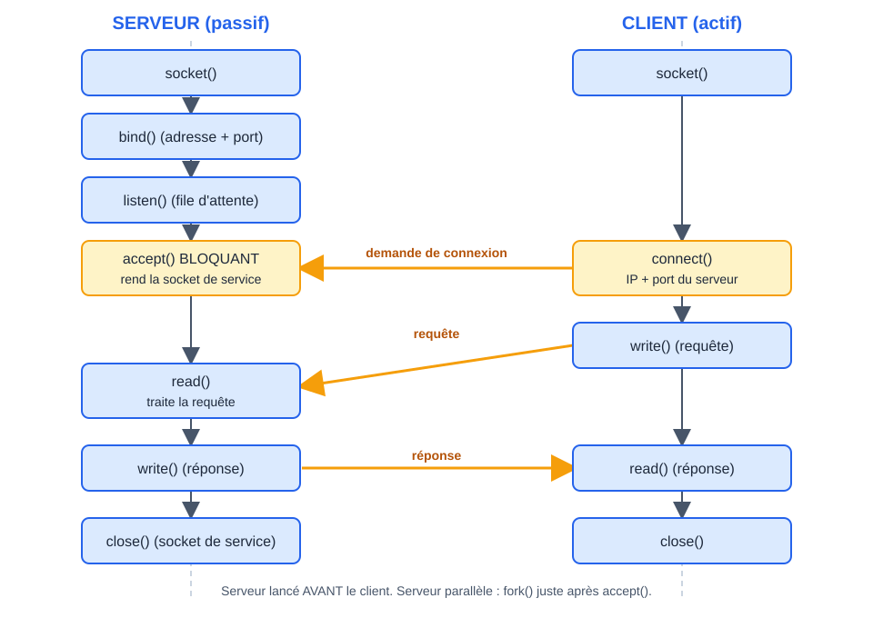

# CM 5 — Les sockets

> **Info :** À retenir
> Une socket est un point de communication bidirectionnel manipulé comme un fichier (descripteur).
> Côté serveur TCP il y a deux sockets : celle d'écoute et celle de service (retour de `accept`).
> Pour servir plusieurs clients en même temps : `fork` (ou thread) après `accept`.

## À savoir faire
- Dire ce qu'est une **socket** (système : descripteur de fichier ; réseau : point de communication IP + port + protocole).
- Dérouler **dans l'ordre** les appels d'un serveur TCP et d'un client TCP.
- Expliquer le rôle de `bind`, `listen`, `accept`, `connect`.
- Différencier la **socket d'écoute** et la **socket de service** renvoyée par `accept`.
- Comparer **TCP et UDP** (connecté / non connecté) et citer les appels d'un serveur UDP.
- Expliquer serveur **itératif** vs **parallèle** et pourquoi un serveur itératif ralentit avec N clients.
- Expliquer `htons` et pourquoi un port inférieur à 1024 demande root.

## Client, serveur, port
- **Serveur** : processus passif, attend les demandes, rend un service. **Client** : processus actif, prend l'initiative.
- Le serveur doit être lancé **avant** le client (sinon `Connection refused`).
- Un service est repéré par un **numéro de port** sur 16 bits (0 à 65535, soit 65536 valeurs). `/etc/services` donne la correspondance (ssh 22, http 80, https 443).

| Plage de ports | Usage |
|---|---|
| 0 | joker : le système choisit un port libre |
| 1 à 1023 | services classiques, **root obligatoire** pour `bind` |
| 1024 à 49151 | services enregistrés, droits ordinaires |
| 49152 à 65535 | ports automatiques (côté client) |

## Une socket, c'est quoi
- **Système** : un descripteur de fichier spécial (3, 4, 5… car 0, 1, 2 sont stdin/stdout/stderr), utilisé avec `read` / `write` / `close`.
- **Réseau IP** : un point de communication identifié par adresse IP + port + protocole (TCP/UDP). Dire « socket = IP + port » est incomplet.
- **Bidirectionnelle**, contrairement à un tube.

| Choix | Valeur | Signification |
|---|---|---|
| Domaine | `AF_UNIX` | local, adresse = nom de fichier |
| | `AF_INET` | réseau IPv4, adresse = IP + port |
| Type | `SOCK_STREAM` | flux d'octets, connecté, fiable = TCP |
| | `SOCK_DGRAM` | datagrammes, non connecté, sans garantie = UDP |

Un client `STREAM` ne peut pas parler à un serveur `DGRAM`.

## Mode connecté (TCP)



Serveur : `socket` → `bind` → `listen` → `accept` → `read`/`write` → `close`.
Client : `socket` → `connect` → `write`/`read` → `close`.

| Appel | Rôle |
|---|---|
| `socket(domaine, type, 0)` | crée la socket, renvoie un descripteur (`-1` si erreur) ; elle n'a pas encore d'adresse |
| `bind` | attache une adresse (IP + port, ou nom de fichier) à la socket : le serveur se « nomme » |
| `listen(sock, n)` | passe en écoute, file de `n` connexions en attente (TCP uniquement) |
| `accept` | **bloque** jusqu'à un client, renvoie une **nouvelle socket de service** dédiée à ce client |
| `connect` | le client demande la connexion à l'adresse du serveur |
| `close` | ferme la socket |

> **Info :** Deux sockets côté serveur
> - **socket d'écoute** : sert uniquement à accepter de nouvelles connexions.
> - **socket de service** (retour de `accept`) : sert à parler à ce client précis.
> Le client n'a pas besoin de `bind` : le système lui attribue un port libre au `connect`.

Adresse réseau à reconnaître :
```c
struct sockaddr_in adr;
adr.sin_family      = AF_INET;
adr.sin_addr.s_addr = htonl(INADDR_ANY);  // toutes les interfaces de la machine
adr.sin_port        = htons(1664);        // port au format réseau
```
`htons` (16 bits, port) et `htonl` (32 bits, IP) convertissent l'ordre des octets de la machine (little-endian sur PC) vers l'ordre réseau (big-endian). Sans `htons`, 1664 est lu 32774.

## Mode non connecté (UDP)
- **Pas de `listen`, pas d'`accept`, pas de `connect`**.
- Chaque message porte l'adresse du destinataire : `sendto` / `recvfrom`. Le serveur apprend l'adresse du client avec `recvfrom` et répond avec `sendto`.
- Aucune garantie : perte, doublon, désordre possibles.
- Serveur UDP (annale 2022-2022, ex. 2.2) : `socket`, `bind`, `recvfrom`, `sendto`, `close`. Client : `socket`, `sendto`, `recvfrom`, `close` (`bind` pas obligatoire).

| | TCP (`SOCK_STREAM`) | UDP (`SOCK_DGRAM`) |
|---|---|---|
| Connexion | oui | non |
| Fiabilité, ordre | oui | non |
| Primitives | `read` / `write` | `sendto` / `recvfrom` |
| Usage | échanges longs (web, ssh) | requêtes courtes, rapidité |

## Serveur itératif et parallèle
- **Itératif** : `accept`, traite le client, `close`, puis seulement `accept` suivant. Avec N clients, le dernier attend les N−1 premiers.
- **Parallèle** : après `accept`, le père crée un **fils** (`fork`) ou un **thread** qui dialogue avec ce client, et revient aussitôt à `accept`.

```c
signal(SIGCHLD, SIG_IGN);                    // pas de zombies
while (1) {
    int svc = accept(sock, NULL, NULL);
    if (fork() == 0) {                       // FILS : sert ce client
        close(sock);                         //   n'a pas besoin de la socket d'écoute
        /* service */
        close(svc); exit(0);
    }
    close(svc);                              // PÈRE : n'a pas besoin de la socket de service
}
```

**À toi de jouer — les deux sockets d'un serveur parallèle** : la table des descripteurs du père, puis du fils (`tty` = terminal, `éco` = socket d'écoute, `svc` = socket de service)
```pas-a-pas
{
  "titre": "accept puis fork : qui garde quelle socket ?",
  "code": [
    "while (1) {",
    "    int svc = accept(sock, NULL, NULL);",
    "    if (fork() == 0) {",
    "        close(sock);",
    "        /* service */",
    "        close(svc); exit(0);",
    "    }",
    "    close(svc);",
    "}"
  ],
  "etapes": [
    {"ligne":0,"vars":{"table de":"père"},"note":"Le serveur a déjà fait socket, bind et listen : sock (descripteur 3) est la socket d'écoute. Elle ne sert qu'à accepter de nouvelles connexions.","schema":{"type":"tableau","cases":["tty","tty","tty","éco","–"],"marques":{"sock":3,"svc":4}}},
    {"ligne":1,"note":"accept bloque jusqu'à l'arrivée d'un client, puis renvoie une NOUVELLE socket, svc : la socket de service, dédiée à ce client. Le client n'a pas besoin de bind.","schema":{"type":"tableau","cases":["tty","tty","tty","éco","svc"],"marques":{"sock":3,"svc":4},"surligne":[4]}},
    {"ligne":2,"note":"fork : le fils reçoit une copie de la table, donc il a les deux sockets. Père et fils ont maintenant chacun les deux.","schema":{"type":"tableau","cases":["tty","tty","tty","éco","svc"],"marques":{"sock":3,"svc":4}}},
    {"ligne":3,"vars":{"table de":"fils"},"note":"Le fils ferme la socket d'écoute : il ne sert que son client.","schema":{"type":"tableau","cases":["tty","tty","tty","–","svc"],"marques":{"sock":3,"svc":4}}},
    {"ligne":5,"note":"Il dialogue avec le client, puis ferme sa socket de service et termine.","schema":{"type":"tableau","cases":["tty","tty","tty","–","–"],"marques":{"sock":3,"svc":4},"fixes":[]}},
    {"ligne":7,"vars":{"table de":"père"},"note":"Le père ferme la socket de service : elle ne le concerne plus. Il garde seulement la socket d'écoute.","schema":{"type":"tableau","cases":["tty","tty","tty","éco","–"],"marques":{"sock":3,"svc":4}}},
    {"ligne":0,"note":"Le père revient aussitôt à accept pour le client suivant : pendant ce temps le fils sert le premier. C'est ce qui rend le serveur parallèle, alors qu'un serveur itératif ferait attendre les autres clients.","schema":{"type":"tableau","cases":["tty","tty","tty","éco","–"],"marques":{"sock":3,"svc":4},"surligne":[3]}}
  ]
}
```
- Le père ferme la socket de service, le fils ferme la socket d'écoute. Le père récolte les fils (`wait` ou `SIGCHLD`) pour éviter les zombies.
- Variantes : un thread par client (`pthread_create`), ou `select` (multiplexage de plusieurs descripteurs).
- Pourquoi « en même temps » : plusieurs cœurs, et sinon l'ordonnanceur du noyau partage le temps (quantum de quelques millisecondes).

## Annales
- **2022-2022** : ex. 1 Q7 (socket côté système et réseau) ; ex. 2.2 (appels et déroulé d'un serveur UDP, servir plusieurs clients).
- **2022-2023** : ex. 2.3 serveur parallèle sur le port 22 (service SSH ; à chaque connexion `accept` renvoie une nouvelle socket puis `fork`) ; Q9 taille d'un tube et d'une socket = 0.
- **2024-2025** : Q10 et ex. 2.3 « je vous rends un service à tous » (serveur itératif trop lent, solution `fork` / thread après `accept`).

## Erreurs classiques
| Message / symptôme | Cause |
|---|---|
| `connect: Connection refused` | serveur pas lancé ou mauvais port |
| `bind: Address already in use` | port ou nom déjà utilisé |
| `bind: Permission denied` | port < 1024 sans être root |
| Port affiché 32774 au lieu de 1664 | oubli de `htons` |
| Un seul client servi à la fois | serveur itératif : passer en parallèle |
| Zombies côté serveur parallèle | père n'ignore pas `SIGCHLD` / pas de `wait` |
| Programme tué à l'écriture | `SIGPIPE` : l'autre côté a fermé |
